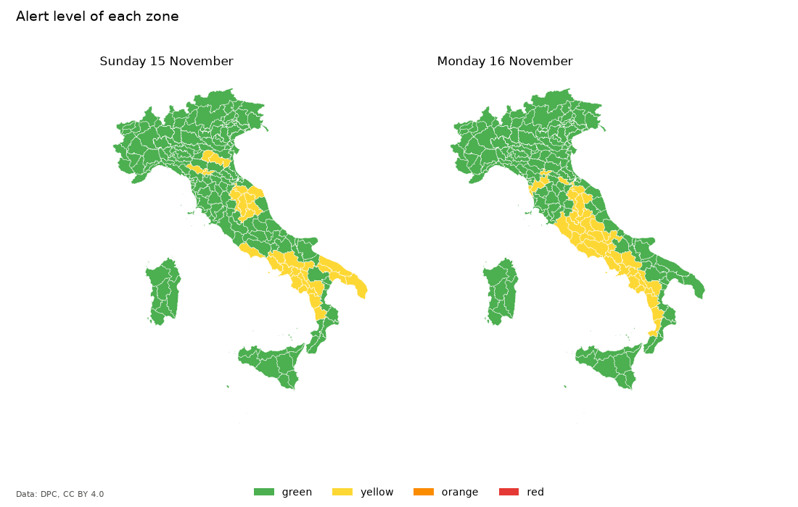

# aiodpc

Async Python client for the open data of the Italian Civil Protection
Department (Dipartimento della Protezione Civile, DPC): the national alert
bulletins.

- **Bollettino di criticità idrogeologica e idraulica**: the alert level
  (green, yellow, orange, red) of each alert zone for today and tomorrow, for
  the hydraulic, thunderstorm and hydrogeological risks.
- **Bollettino di vigilanza meteorologica**: the expected precipitation of each
  vigilance zone for today, tomorrow and the day after, and the significant
  weather phenomena (heavy rain, wind, sea storms, frost, fog, temperatures).

Given a location (coordinates, optionally a municipality), aiodpc tells
whether it has a risk and which one, or returns the bulletins of its zone, day
by day. It is built on `asyncio` and `aiohttp`, has no Home Assistant
dependency and is fully typed.

## Installation

```bash
pip install aiodpc
```

Python 3.13 or later is required.

## Tutorial: from one question to the whole country

This tutorial grows like a math class: it starts with a yes or no about one
place and ends with every zone of Italy. It follows a practical story: a
network of **community kitchens** in several Italian cities that wants to warn
its volunteers and guests the day before an alert. The same steps serve a
school, a sports club, a parish, a farm or a town hall.

Every example is a complete script: copy, paste and run it. The outputs shown
are real, run on the afternoon of 15 November 2026.

The [tutorial notebook](https://github.com/webysther/aiodpc/blob/main/examples/tutorial.ipynb)
tells the same story with the maps of the alerts and the weather phenomena,
drawn from the data.

### 1. One place, one question

The simplest question has a yes or no answer: is there an alert in Rome
today? An alert is any level from yellow up.

```python
import asyncio

from aiodpc import DpcClient


async def main() -> None:
    async with DpcClient() as dpc:
        rome = dpc.location(41.9, 12.5)
        print(await rome.has_risk())


asyncio.run(main())
```

```text
False
```

### 2. Which risk, and until when

A yes needs more: which level, which risk and until when. The bulletin is
published in the afternoon and also covers tomorrow, which leaves time to warn
people. From midnight until the next bulletin, tomorrow is not published yet:
`risk()` then raises `DpcNoDataError`.

```python
import asyncio

from aiodpc import Day, DpcClient, DpcNoDataError


async def main() -> None:
    async with DpcClient() as dpc:
        rome = dpc.location(41.9, 12.5)
        for day in (Day.TODAY, Day.TOMORROW):
            try:
                risk = await rome.risk(day)
            except DpcNoDataError:  # after midnight, until DPC publishes
                print(f"{day.date()}: not published yet")
                continue
            print(f"{day.date()}: {risk}")
            print(f"  DPC says: {risk.description}")
            print(f"  valid until {risk.valid_until:%Y-%m-%d %H:%M}")


asyncio.run(main())
```

```text
2026-11-15: green
  DPC says: Assenza di fenomeni significativi prevedibili
  valid until 2026-11-16 00:00
2026-11-16: yellow (hydrogeological)
  DPC says: Ordinaria per rischio idrogeologico
  valid until 2026-11-17 00:00
```

A risk has:

- `level`: an `AlertLevel`, `green`, `yellow`, `orange` or `red`. Levels are
  ordered (`risk.level >= AlertLevel.ORANGE`); yellow and higher are alerts
  (`risk.is_alert`).
- `types`: the `RiskType`s at that level: `HYDRAULIC`, `THUNDERSTORMS`,
  `HYDROGEOLOGICAL`.
- `description`: the DPC summary, in Italian; `valid_until`: the midnight
  (Europe/Rome) that ends the day; `day`: the complete assessment of the day.

The location keeps its bulletin: it checks for a new one at most once a
minute and downloads it only when DPC publishes one, so `has_risk()` and
`risk()` can be called as often as needed.

### 3. The whole day: three risks and the weather

One level per day sums up three assessments: hydraulic (the main rivers),
thunderstorms and hydrogeological (landslides and the minor streams). The
second bulletin, the weather vigilance, adds the expected precipitation of the
next three days and the significant phenomena near the place.

```python
import asyncio

from aiodpc import DpcClient, Location

ROME = Location(41.9, 12.5)


async def main() -> None:
    async with DpcClient() as dpc:
        alerts = await dpc.get_criticality(ROME)
        weather = await dpc.get_vigilance(ROME, phenomena_within_km=30)

    for day in alerts:
        print(f"{day.date} {day.zone}: {day.level}")
        for risk in day.risks:
            print(f"  {risk.type:<16} {risk.level:<7} {risk.description}")

    for day in weather:
        print(f"{day.date} {day.zone}: {day.precipitation} precipitation")
        for phenomenon in day.phenomena:
            print(f"  {phenomenon.type}, {phenomenon.distance_km} km {phenomenon.direction}")


asyncio.run(main())
```

```text
2026-11-15 Bacini di Roma: green
  hydraulic        green   Assenza di fenomeni significativi prevedibili
  thunderstorms    green   Assenza di fenomeni significativi prevedibili
  hydrogeological  green   Assenza di fenomeni significativi prevedibili
2026-11-16 Bacini di Roma: yellow
  hydraulic        green   Assenza di fenomeni significativi prevedibili
  thunderstorms    green   Assenza di fenomeni significativi prevedibili
  hydrogeological  yellow  Ordinaria
2026-11-15 Comune di Roma: light precipitation
  scattered_rain, 25.2 km SW
2026-11-16 Comune di Roma: light precipitation
  scattered_rain, 20.2 km WNW
2026-11-17 Comune di Roma: light precipitation
  scattered_rain, 27.3 km SE
```

A criticality day has the `level` of its zone and the assessment of each risk
type: `day.hydraulic`, `day.thunderstorms`, `day.hydrogeological` (all of them
in `day.risks`). A vigilance day has the expected `precipitation` (a
`Precipitation`, from `none` to `very_heavy`) and the significant `phenomena`
near the location. A phenomenon's `type` (a `PhenomenonType`, such as
`light_snow`) says in English what its Italian `description` says, and its
`key`, its code and position, identifies it among those of its day, from one
bulletin to the next.

### 4. Many places, one download

Now the whole network of kitchens. Each bulletin is a single file for all of
Italy (about 18 MB a day for both), so download it once with
`get_criticality_map()` or `get_vigilance_map()` and read it at each place with
`at()`, which makes no request. A municipality makes the answer more precise,
since large cities span several zones, and a place outside Italy has no zone.

```python
import asyncio

from aiodpc import DpcClient, DpcLocationError, Location

KITCHENS = {
    "Turin": Location(45.07, 7.69, municipality="Torino"),
    "Milan": Location(45.46, 9.19, municipality="Milano"),
    "Bologna": Location(44.49, 11.34, municipality="Bologna"),
    "Florence": Location(43.77, 11.25, municipality="Firenze"),
    "Rome": Location(41.9, 12.5, municipality="Roma"),
    "Naples": Location(40.85, 14.27, municipality="Napoli"),
    "Palermo": Location(38.12, 13.36, municipality="Palermo"),
    "Lugano": Location(46.0, 8.95),  # Switzerland: no DPC zone
}


async def main() -> None:
    async with DpcClient() as dpc:
        criticality = await dpc.get_criticality_map()  # one download for all

    for city, place in KITCHENS.items():
        try:
            tomorrow = criticality.at(place).tomorrow
        except DpcLocationError:
            print(f"{city:<9} not covered by DPC")
            continue
        if tomorrow is None:  # after midnight, until DPC publishes
            print(f"{city:<9} not published yet")
            continue
        notice = "send a notice" if tomorrow.is_alert else "-"
        print(f"{city:<9} {tomorrow.level:<7} {notice:<14} {tomorrow.zone}")


asyncio.run(main())
```

```text
Turin     green   -              Pianura Torinese e Colline
Milan     green   -              Nodo Idraulico di Milano
Bologna   green   -              Collina bolognese
Florence  green   -              Arno-Firenze
Rome      yellow  send a notice  Bacini di Roma
Naples    yellow  send a notice  Piana campana, Napoli, Isole e Area vesuviana
Palermo   green   -              Nord-Occidentale e isole Egadi e Ustica
Lugano    not covered by DPC
```

`at()` raises `DpcLocationError` for a place outside every zone without
affecting the others. A map holds the decoded files (tens of MB): keep it only
while reading it. `at()` does no I/O, so it can also run in an executor.

### 5. The whole country

From a list of places to every zone of Italy, one level down: the DPC files
themselves, as typed objects with each zone, its municipalities and its shape.
They need the `schema` extra:

```bash
pip install "aiodpc[schema]"
```

```python
import asyncio
from collections import Counter

from aiodpc import DpcClient
from aiodpc.parsers import parse_assessment


async def main() -> None:
    async with DpcClient() as dpc:
        files = await asyncio.gather(
            dpc.get_criticality_file(offset=0), dpc.get_criticality_file(offset=1)
        )

    for day, file in enumerate(files, start=1):
        levels = Counter(
            parse_assessment(zone.properties.summary).level for zone in file.features
        )
        counts = ", ".join(f"{count} {level}" for level, count in sorted(levels.items()))
        print(f"day {day}: {len(file.features)} zones, {counts}")


asyncio.run(main())
```

```text
day 1: 187 zones, 157 green, 30 yellow
day 2: 187 zones, 151 green, 36 yellow
```

The shapes of the zones turn these numbers into a map: the
[tutorial notebook](https://github.com/webysther/aiodpc/blob/main/examples/tutorial.ipynb)
draws it with matplotlib.



### 6. Keeping watch

Back to one place, with everything learned: a script that runs all the time
and writes the notice to share as soon as DPC announces an alert for tomorrow.

```python
import asyncio

from aiodpc import Day, DpcClient, DpcNoDataError

CHECK_EVERY_SECONDS = 30 * 60


async def main() -> None:
    async with DpcClient() as dpc:
        rome = dpc.location(41.9, 12.5, municipality="Roma")
        announced = None
        while True:
            try:
                risk = await rome.risk(Day.TOMORROW)
            except DpcNoDataError:  # after midnight, until DPC publishes
                risk = None
            if risk is not None and risk.is_alert and risk.day != announced:
                announced = risk.day
                print(
                    f"Notice for {risk.day.date:%A %d %B}: {risk.level} alert "
                    f"in {risk.day.zone} for {', '.join(risk.types)} risk.\n"
                    f"DPC: {risk.description}. Follow the official channels."
                )
            await asyncio.sleep(CHECK_EVERY_SECONDS)


asyncio.run(main())
```

```text
Notice for Monday 16 November: yellow alert in Bacini di Roma for hydrogeological risk.
DPC: Ordinaria per rischio idrogeologico. Follow the official channels.
```

Asking every 30 minutes costs little: `rome` downloads the bulletin only when
DPC publishes a new one. The criticality bulletin is published every day by
16:00 (Europe/Rome) and may be re-issued later the same day
("Aggiornamento"); the vigilance bulletin by 15:00.

### 7. Every language

DPC writes in Italian, but the kitchens' volunteers and guests speak many
languages. Every value of the bulletins has a text in thirteen of them:
English, Italian, Brazilian Portuguese, French, German, Spanish, Simplified
Chinese, Romanian, Arabic, Ukrainian, Albanian, Bengali and Hindi. So the same
notice can be written in each of them, the DPC description included.

```python
import asyncio

from aiodpc import Day, DpcClient, DpcNoDataError, Language, Translator


async def main() -> None:
    async with DpcClient() as dpc:
        rome = dpc.location(41.9, 12.5, municipality="Roma")
        try:
            risk = await rome.risk(Day.TOMORROW)
        except DpcNoDataError:  # after midnight, until DPC publishes
            print("Tomorrow is not published yet")
            return

    for language in Language:
        tell = Translator(language)
        print(f"{language:<7} {tell(Day.TOMORROW)}: {tell.risk(risk)}.")
        print(f"        DPC: {tell.description(risk)}.")


asyncio.run(main())
```

```text
en      Tomorrow: Yellow alert for hydrogeological risk.
        DPC: Ordinary criticality for hydrogeological risk.
it      Domani: Allerta gialla per rischio idrogeologico.
        DPC: Ordinaria per rischio idrogeologico.
pt-BR   Amanhã: Alerta amarelo para risco hidrogeológico.
        DPC: Criticidade ordinária para risco hidrogeológico.
fr      Demain: Alerte jaune pour risque hydrogéologique.
        DPC: Criticité ordinaire pour risque hydrogéologique.
de      Morgen: Gelbe Warnung für hydrogeologisches Risiko.
        DPC: Geringes Gefährdungspotenzial für hydrogeologisches Risiko.
es      Mañana: Alerta amarilla por riesgo hidrogeológico.
        DPC: Criticidad ordinaria por riesgo hidrogeológico.
zh-Hans 明天: 水文地质风险黄色预警.
        DPC: 水文地质风险一般危急程度.
ro      Mâine: Alertă galbenă pentru risc hidrogeologic.
        DPC: Criticitate ordinară pentru risc hidrogeologic.
ar      غداً: إنذار أصفر — الخطر الهيدروجيولوجي.
        DPC: خطورة عادية — الخطر الهيدروجيولوجي.
uk      Завтра: Жовте попередження — гідрогеологічний ризик.
        DPC: Звичайна критичність — гідрогеологічний ризик.
sq      Nesër: Paralajmërim i verdhë për rrezik hidrogjeologjik.
        DPC: Kritikalitet i zakonshëm për rrezik hidrogjeologjik.
bn      আগামীকাল: হলুদ সতর্কতা — জলভূতাত্ত্বিক ঝুঁকি.
        DPC: সাধারণ সংকটমাত্রা — জলভূতাত্ত্বিক ঝুঁকি.
hi      कल: जल-भूवैज्ञानिक जोखिम के लिए पीली चेतावनी.
        DPC: जल-भूवैज्ञानिक जोखिम के लिए सामान्य गंभीरता.
```

`Translator("pt-BR")` also takes tags such as `"pt_BR"` or `"it-IT"`. See
[Translations](#translations) for what it covers.

## Reference

### Days and validity

Each day carries its calendar `date` and `valid_until`, the midnight
(Europe/Rome) that ends it. Look days up by date rather than by position:
`bulletin.today`, `bulletin.tomorrow`, `bulletin.after_tomorrow` (vigilance
only) or `bulletin.on(date)`. After midnight the bulletin published the day
before still answers `today` with its second day until DPC publishes a new
one.

By default, days that are already over are not downloaded
(`skip_expired=False` to get them all, e.g. for a past `bulletin_id`).

### Polling the bulletins

`dpc.location()` polls efficiently for you. With the bulletins of
`get_criticality()` and `get_vigilance()`, check the latest ID and fetch the
bulletin only when it changed.

<details>
<summary>Example</summary>

```python
import asyncio

from aiodpc import BulletinKind, DpcClient, Location

ROME = Location(41.9, 12.5)
CHECK_EVERY_SECONDS = 30 * 60


async def main() -> None:
    async with DpcClient() as dpc:
        alerts = await dpc.get_criticality(ROME)
        print(f"Bulletin {alerts.id}")
        while True:
            await asyncio.sleep(CHECK_EVERY_SECONDS)
            latest = await dpc.latest_bulletin_id(BulletinKind.CRITICALITY)
            if latest != alerts.id:
                alerts = await dpc.get_criticality(ROME, bulletin_id=latest)
                print(f"New bulletin {alerts.id}")


asyncio.run(main())
```

</details>

Pass your own session with `DpcClient(session)`; the client never closes a
session it did not create.

### Raw DPC files

With `aiodpc[schema]`, the DPC files are available as typed DTOs, with clean
names for the DPC fields (`zone_name` for `"Nome zona"`), as in step 5. The
DTOs are strict, which is their purpose: when DPC changes its format they
raise `DpcParseError` saying where, e.g. ``Object missing required field `Nome
zona` - at `$.features[1].properties` ``. New fields are ignored. The rest of
aiodpc does not use them and keeps working when the data is incomplete.
`get_criticality_file()`, `get_vigilance_file()` and `get_phenomena_file()`
cover the three files; `aiodpc.schema` decodes files fetched by other means.

### Municipality

With `dpc.location(41.9, 12.5, municipality="Roma")` or
`Location(41.9, 12.5, municipality="Roma")`, the zones that list the
municipality within 60 km of the coordinates are considered and the one with
the highest level is used; `zone` is the zone containing the coordinates.
Large municipalities span several zones.

DPC lists the municipalities by name, and a few names belong to two
municipalities far apart, such as Peglio, in Lombardy and in the Marche: the
zones far from the coordinates list the other one. When no zone near the
coordinates lists the municipality, the zone containing them is used, with a
warning.

In South Tyrol either the Italian or the German name works (`"Bolzano"` or
`"Bozen"`), although DPC writes them as `"Bolzano/Bozen"` in the criticality
bulletin and as `"Bolzano"` in the vigilance bulletin.

### Coverage check

`await dpc.is_location_covered(Location(lat, lon))` returns whether the
coordinates are inside a DPC alert zone, for example to validate a
configuration.

`await dpc.get_alert_zone(Location(lat, lon))` returns the alert zone of the
coordinates with its municipalities (`zone.name`, `zone.municipalities`), for
example to let a user pick a municipality, and raises `DpcLocationError` when
the coordinates are in no zone.

### Errors

All errors derive from `DpcError`:

- `DpcConnectionError`: network error, HTTP error status or timeout.
- `DpcParseError`: invalid JSON or unexpected data format.
- `DpcLocationError`: the location is not inside any zone of the bulletin.
- `DpcNoDataError`: no published bulletin covers the requested day.

Invalid arguments (coordinates, bulletin IDs) raise `ValueError`.

### Translations

Every value of the models is an enum: `AlertLevel`, `Criticality`,
`RiskType`, `Precipitation`, `PhenomenonCategory`, `PhenomenonType`,
`CompassPoint`, `Day` and `BulletinKind`. They print as English codes
(`orange`, `ordinary`, `hydrogeological`, `very_heavy`, `light_snow`, `WNW`),
ready to be used as translation keys. The texts DPC writes are kept in
Italian (`description`), and read into enums: `criticality` (`"Ordinaria"` is
`Criticality.ORDINARY`) and `mapped_risk`, the one risk the summary of a zone
names, the one the DPC map shows.

`aiodpc.i18n` has a text for every value in English, Italian, Brazilian
Portuguese, French, German, Spanish, Simplified Chinese, Romanian, Arabic,
Ukrainian, Albanian, Bengali and Hindi; the tests check that none is missing.
A `Translator` tells them in one language:

- `tell(value)`: the label of any value, e.g. `tell(AlertLevel.YELLOW)` is
  "Alerta amarelo" in Brazilian Portuguese.
- `tell.risk(risk)`: the alert and its risk types, "Alerta amarelo para risco
  hidrogeológico".
- `tell.description(risk)`, also of a `CriticalityDay` or `RiskAssessment`:
  the DPC text, "Criticidade ordinária para risco hidrogeológico". In
  Italian it is the text DPC wrote; a text aiodpc does not recognise is
  returned as DPC wrote it rather than lost.
- `tell.phenomenon(phenomenon)`: "Chuvas esparsas ou intermitentes, 20,2 km
  ONO", with the decimal separator and compass points of the language.

The names of the zones and municipalities are proper names and are not
translated. `Language.of(tag)` returns the language of a tag, or `None` when
aiodpc does not speak it; `aiodpc.i18n.TRANSLATIONS` holds every text.

The [data dictionary](https://github.com/webysther/aiodpc/blob/main/docs/data-dictionary.xlsx)
lists every field of the DPC files and every value they take, with a numeric
code, the text DPC writes and its translations, as a proposal of data model.

### Numeric codes and compact bulletins

Every value has a numeric `code`, and `from_code()` gives it back:
`AlertLevel.YELLOW.code` is 2, `RiskType.from_code(3)` is
`RiskType.HYDROGEOLOGICAL`. Where DPC publishes a code it is that code
(`id_fenomeno` for `PhenomenonType`, `id_classificazione` for
`Precipitation`); the others are aiodpc's, listed in the
[data dictionary](https://github.com/webysther/aiodpc/blob/main/docs/data-dictionary.xlsx).
Codes never change once released.

`CriticalityMap.compact()` and `VigilanceMap.compact()` give a whole bulletin
as numbers: one record of codes per zone and day, and the zones in a table of
their own (`ZoneTable`), coded by their position in name order. The zones are
almost all the bytes of the DPC files and change rarely; the table's
`fingerprint` changes when they do, so a consumer keeps the table and fetches
it again only then. `to_json()` writes a bulletin as one JSON document on a
single line, with the records and, for the vigilance bulletin, the
phenomena: the bulletins of a period are a JSON Lines file, one per line. The
zone table has `to_json()` and `to_geojson()` (the shapes, to publish once
per fingerprint).

```python
import asyncio
import json

from aiodpc import AlertLevel, DpcClient, RiskType, Translator


async def main() -> None:
    async with DpcClient() as dpc:
        criticality = (await dpc.get_criticality_map()).compact()
        vigilance = (await dpc.get_vigilance_map()).compact()

    documents = {
        "criticality": criticality.to_json(),
        "vigilance": vigilance.to_json(),
        "zones": criticality.zones.to_json(),
    }
    for name, text in documents.items():
        print(f"{name:<12} {len(text.encode()):>7,} bytes")
    print(json.loads(documents["criticality"])["columns"])

    # One bulletin per line: the history of the bulletins as JSON Lines
    with open("criticality.jsonl", "a", encoding="utf-8") as file:
        file.write(documents["criticality"] + "\n")

    # The codes give the values back, in any language
    tell = Translator("pt-BR")
    rome = criticality.zones.code_of("Bacini di Roma")
    for record in criticality.records:
        if record.zone == rome:
            risk = RiskType.from_code(record.mapped_risk)
            print(record, tell(AlertLevel(record.level)), risk and tell(risk))


asyncio.run(main())
```

Run on 16 November 2026, when the criticality bulletin of the day before
still covered its second day:

```text
criticality    3,822 bytes
vigilance      5,742 bytes
zones        123,624 bytes
['day', 'zone', 'level', 'criticality', 'mapped_risk', 'hydraulic', 'thunderstorms', 'hydrogeological']
CriticalityRecord(day=1, zone=30, level=2, criticality=2, mapped_risk=3, hydraulic=1, thunderstorms=1, hydrogeological=2) Alerta amarelo Risco hidrogeológico
```

A full day of both bulletins is about 15 kB of JSON instead of 19 MB of
GeoJSON. The [study](https://github.com/webysther/aiodpc/blob/main/docs/study/en.md)
measures it and proposes this model to DPC.

The bulletins of a whole quarter in this form, one JSON document per line,
are in [`data`](https://github.com/webysther/aiodpc/tree/main/data), with
examples in pandas and DuckDB: 1.1 MB for the 1.8 GB that DPC published in
the third quarter of 2026.

### Low-level API

- `aiodpc.parsers`: pure parsing functions taking the decoded GeoJSON, to parse
  one download for several locations or to test without network.
- `aiodpc.urls`: URLs of the bulletin files.
- `aiodpc.discovery`: the latest bulletin ID is read from the DPC map pages by
  default (`MapPageIdSource`); implement `BulletinIdSource` to use another
  source.

## Data source and attribution

The data is published by the Dipartimento della Protezione Civile on
[mappe.protezionecivile.gov.it](https://mappe.protezionecivile.gov.it/) and
GitHub
([pcm-dpc/DPC-Bollettini-Criticita-Idrogeologica-Idraulica](https://github.com/pcm-dpc/DPC-Bollettini-Criticita-Idrogeologica-Idraulica),
[pcm-dpc/DPC-Bollettini-Vigilanza-Meteorologica](https://github.com/pcm-dpc/DPC-Bollettini-Vigilanza-Meteorologica))
under the [Creative Commons Attribution 4.0 International (CC BY 4.0)](https://creativecommons.org/licenses/by/4.0/)
license. Applications showing the data must credit:

> Dipartimento della Protezione Civile – Presidenza del Consiglio dei Ministri

The text is available as `aiodpc.ATTRIBUTION`.

This project is not affiliated with or endorsed by DPC. The bulletins are
official, but this library is not: for safety decisions, always refer to
the official DPC and regional channels.

## Development

```bash
python -m venv .venv && . .venv/bin/activate
pip install --editable . --group dev   # pip >= 25.1
ruff format --check . && ruff check .
mypy
pytest --cov
```

To write the data dictionary again from the tables of aiodpc:

```bash
pip install --editable . --group docs
python docs/data_dictionary.py
```

To run the tutorial notebook again with today's bulletins (it also writes
`examples/alert-map.png`, the map of the README):

```bash
pip install --editable . --group notebook
jupyter nbconvert --to notebook --execute --inplace examples/tutorial.ipynb
```

The tests never reach DPC: a local HTTPS server answers for the DPC hosts.
`tests/fixtures/real` holds unmodified excerpts of real bulletins to guard the
data format.

To release, set `__version__` in `src/aiodpc/__init__.py`, describe the
changes in a `## [X.Y.Z] - Unreleased` section of [CHANGELOG.md](CHANGELOG.md),
commit, then run `./publish.sh X.Y.Z` (`--dry-run` first to preview). It
creates the GitHub release with the changelog notes, and the release workflow
publishes to PyPI.

## Credits

aiodpc is written by Webysther Sperandio. It derives from the
[DPC Alert](https://github.com/caiosweet/Home-Assistant-custom-components-DPC-Alert)
Home Assistant integration by caiosweet (MIT license).

## Citation

To cite aiodpc or its [study of the DPC data](https://github.com/webysther/aiodpc/blob/main/docs/study/en.md),
use [`CITATION.cff`](https://github.com/webysther/aiodpc/blob/main/CITATION.cff)
("Cite this repository" on GitHub) or the "How to cite" section of the study.

## License

MIT, see [LICENSE](LICENSE).
