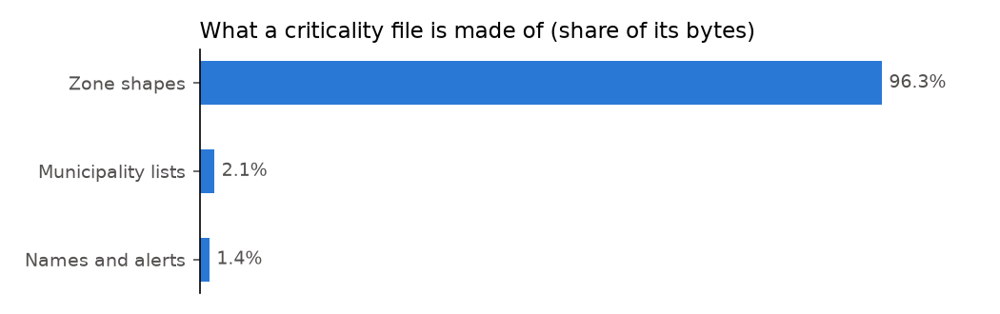
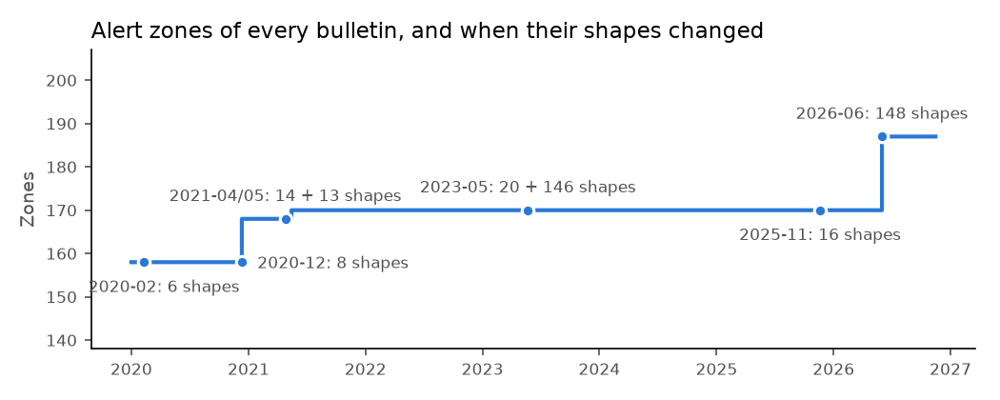
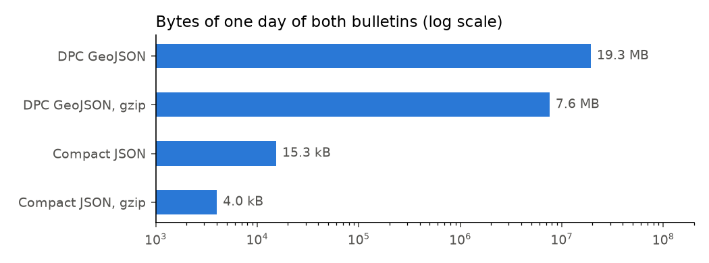

# The DPC alert bulletins as open data: a lighter model

**Webysther Sperandio** · Version 1 · 16 November 2026 ·
[Versione italiana](it.md)

*A study of the open data of the national bulletins of the Italian Civil
Protection Department (Dipartimento della Protezione Civile, DPC), with a
proposal.*

Every number below is measured by [`measure.py`](measure.py), which anyone can
run again; its output is [`results.json`](results.json). The measurements use
the bulletins published up to 15 November 2026.

## Summary

Every afternoon DPC publishes two bulletins for the whole of Italy: the
**criticality bulletin** (the alert level of each alert zone for the
hydraulic, thunderstorm and hydrogeological risks, for today and tomorrow) and
the **weather vigilance bulletin** (the expected precipitation of each
vigilance zone and the significant weather phenomena, for three days). They
are published as open data, under CC BY 4.0, in GeoJSON and other formats.

- One day of both bulletins is **19.3 MB** of GeoJSON. The alerts themselves
  are a few kilobytes of it: **96%** of a criticality file is the shape of the
  zones, which is the same every day.
- The same information as numeric codes is **15.3 kB** of JSON, **1,259
  times smaller** (4.0 kB compressed, 1,894 times smaller than the compressed
  GeoJSON). The 189 bulletins of July to September 2026 take 1.1 MB as JSON
  Lines, against 1.83 GB of GeoJSON. The shapes and the municipalities go in a reference published only
  when they change: the shapes changed in 8 of the 2,571 bulletins measured
  since 2020, and the reference would have had 15 versions.
- Every value of the bulletins belongs to a small closed set. Over 2,572
  bulletins since 2020, the Italian texts are four criticalities and three
  risks, each criticality always with the same alert level. They can be
  numeric codes, which any application can tell in any language.
- The files have defects that a model with codes avoids: characters lost by
  encoding errors in every file, a zone name cut at 150 bytes, municipality
  lists that grew with each bulletin up to 748,705 repeated names, bulletins
  without municipalities, two spellings of the same fields, zones renamed
  without an identifier that stays, and coordinates with 15 decimals where 6
  are enough.

The proposal: keep the current files, and publish next to them a versioned
reference of the zones (with stable codes and the ISTAT codes of the
municipalities) and, for each bulletin, a small JSON document of numeric
codes, following the [data dictionary](../data-dictionary.xlsx).

## 1. Research design

### 1.1 Design science

The study follows design science research, which builds an artefact to solve
a relevant problem and evaluates it rigorously (Hevner et al., 2004), in the
six activities of the design science research methodology (Peffers et al.,
2007). Its artefact is a data model, with its proof of concept; the
contribution is an improvement of a known problem with a new solution
(Gregor & Hevner, 2013).

| Activity (Peffers et al., 2007) | In this study |
|---|---|
| Problem identification and motivation | Sections 2 to 6: size, redundancy, Italian-only texts, defects |
| Objectives of a solution | Section 7: smaller, in no language, with stable identifiers, without breaking the current files |
| Design and development | The data dictionary, the daily documents of codes, the reference of the zones, their implementation in aiodpc |
| Demonstration | Section 9: the proof of concept on a fixed bulletin, and a quarter of bulletins as JSON Lines |
| Evaluation | Section 8, measured; and the tests of aiodpc (707 tests, full coverage; the Italian labels give back every DPC text) |
| Communication | This study, in English and Italian, with its code and data |

### 1.2 Data quality model

The defects are classified with the data quality model of ISO/IEC 25012
(ISO/IEC, 2008), whose characteristics are measured as in ISO/IEC 25024
(ISO/IEC, 2015). It is the model that the Italian open data guidelines
recommend to public administrations for the quality of their data (AgID,
2023, section 5.3). The model extends the
data quality dimensions of Wang and Strong (1996), and has been applied to
Italian open government data (Vetrò et al., 2016).

### 1.3 Data and sampling

- **Census of the summaries**: the summary file of every criticality
  bulletin published from 1 January 2020 to 15 November 2026, 2,572 in all.
- **Census of the zones**: the criticality GeoJSON file of the day of every
  one of those bulletins, 2,571 files and 15.2 GB (one bulletin has none).
  Each file is read as it is downloaded and not kept: what remains is, for
  each zone, a digest (SHA-256) of its shape and of its set of
  municipalities, and for each file the count of its damaged and repeated
  names.
- **Purposive sample**: 73 criticality GeoJSON files (12,250 zone-days),
  drawn at random (seed 7) within three strata of bulletin days chosen for the
  variety of their texts: with a red alert, with an orange alert, with several
  risks at the same level. Purposive sampling selects the cases that inform
  the question best, and does not represent the whole population (Etikan et
  al., 2016); section 10 discusses what follows.
- **One day in full**: the eight files of 15 November 2026.
- **Triangulation** (Denzin, 1978): the closed set of texts is found both in
  the summaries and in the zones of the sample; the encoding defect is
  measured in the files and reported independently on the DPC repository
  ([issue #10](https://github.com/pcm-dpc/DPC-Bollettini-Criticita-Idrogeologica-Idraulica/issues/10)).

### 1.4 Computational reproducibility

The study follows the rules of reproducible computational research (Sandve
et al., 2013; Peng, 2011):

- every number comes from one script, [`measure.py`](measure.py), and is
  written to [`results.json`](results.json); a check compares each number of
  the text with it;
- the inputs are fixed: the last day measured, the bulletin of the day
  measured in full and the seed of the sample are constants of the script, and
  the files of DPC stay published;
- nothing is edited by hand between the data and the figures, which the
  script draws;
- the code, its versions and the tests are public, in the aiodpc repository.

To run it again:

```bash
pip install --editable . --group docs
python docs/study/measure.py CACHE_DIR
```

It downloads about 450 MB into `CACHE_DIR`, reads 15.2 GB more for the
census of the zones while keeping only their digests, and gives the
same numbers, except
the sizes of the repositories, which grow every day, and the reading times,
which depend on the machine.

## 2. What DPC publishes

The bulletins are published on
[mappe.protezionecivile.gov.it](https://mappe.protezionecivile.gov.it/) and in
two GitHub repositories,
[DPC-Bollettini-Criticita-Idrogeologica-Idraulica](https://github.com/pcm-dpc/DPC-Bollettini-Criticita-Idrogeologica-Idraulica)
and
[DPC-Bollettini-Vigilanza-Meteorologica](https://github.com/pcm-dpc/DPC-Bollettini-Vigilanza-Meteorologica).

| Bulletin | Files a day (GeoJSON) | Size | Features |
|---|---|---|---|
| Criticality | today, tomorrow | 2 × 5.53 MB | 187 alert zones |
| Vigilance, zones | today, tomorrow, the day after | 3 × 2.72 MB | 71 vigilance zones |
| Vigilance, phenomena | today, tomorrow, the day after | 0.02 to 0.03 MB | 63 to 91 points |
| **One day** | **8 files** | **19.3 MB** (7.6 MB compressed) | |

Measured on the bulletins of 15 November 2026 (criticality `20261115_1421`,
vigilance `20261115`). The criticality repository counts 2,572 bulletins
from 1 January 2020 to 15 November 2026, on 2,511 days: on 58 days DPC
published an update. The repositories hold every day since, in several
formats (GeoJSON, TopoJSON, shapefile, XML, PDF and images): they weigh
6.6 GB and 12.9 GB (GitHub, 16 November 2026).

Each zone of a criticality file carries its name (`Nome zona`), its
municipalities by name (`Comuni`), its shape, and four texts:

```json
"Rappresentata nella mappa": "Ordinaria per rischio idrogeologico / ALLERTA GIALLA",
"Per rischio idraulico": "Assenza di fenomeni significativi prevedibili / NESSUNA ALLERTA",
"Per rischio temporali": "Assenza di fenomeni significativi prevedibili / NESSUNA ALLERTA",
"Per rischio idrogeologico": "Ordinaria / ALLERTA GIALLA"
```

A vigilance zone carries its name (`Nome_Zona`), its municipalities
(`comuni`), its shape, the class of the expected precipitation
(`id_classificazione`, a number) and its text (`Quantitativi_previsti`). A
phenomenon is a point with a code (`id_fenomeno`, a number).

## 3. What the files are made of



| File | Zone shapes | Municipality lists | Names and alerts |
|---|---|---|---|
| Criticality | 96.3% | 2.1% | 1.4% |
| Vigilance, zones | 93.8% | 5.6% | 0.3% |

The bulletin itself, what changes from one day to the next, is between 0.3%
and 1.4% of a zone file. The phenomena files are small already (20 to 29 kB).

The coordinates of the criticality shapes have up to 15 decimals, those of the
vigilance up to 8. The GeoJSON specification notes that 6 decimals are about
10 cm (Butler et al., 2016, section 11.2): with 6, the criticality shapes are
44.4% smaller and the shapes of a day 32.3% smaller (12.4 MB instead of
18.3 MB), without changing format.

## 4. The zones rarely change



The census compares the zones of each bulletin with those of the previous
one, from 1 January 2020 to 15 November 2026.

- **The shapes are the same from one bulletin to the next.** Of 435,235
  comparisons of a zone with the same zone in the previous bulletin, 434,860
  (99.9%) find the same shape. The shapes changed for good in 8 bulletins:
  10 February 2020 (6 zones), 10 December 2020 (8), 26 April 2021 (14),
  15 May 2021 (13), 23 May 2023 (20), 26 May 2023 (146 of 170),
  20 November 2025 (16) and 1 June 2026 (148 of the 161 zones that stayed).
- **The set of zones changed five times:** "Roma" became "Bacini di Roma" on
  10 February 2020; 158 zones became 168 on 11 December 2020 (18 added, 8
  removed, the day after the 8 removed zones had changed shape), and 170 on
  15 May 2021 (3 added, 1 removed); four zones were renamed on 23 May 2023;
  and there are 187 zones since 1 June 2026 (26 added, 9 removed).
- **Zones are renamed without an identifier that stays.** "Nodo idraulico di
  Milano" became "Nodo Idraulico di Milano" (a capital letter) on 15 May
  2021; "Pianura bolognese di Reno e suoi affluenti" became "Pianura
  bolognese" on 23 May 2023. Matching zones by name across bulletins breaks
  at each change.
- **A reference of the zones would have had 15 versions.** Counting every
  change of the names, the shapes and the sets of municipalities, the zones
  of the 2,571 bulletins come in 15 versions. One of the 14 changes is only
  the encoding error of section 6 reaching the municipality names (8 May
  2024).
- **Some bulletins break, and the next one repairs them.** On 11 May 2023
  two zones of Sicily changed shape for one bulletin and were back the next
  day; six bulletins list no municipalities at all (section 6). A change that
  the next bulletin undoes is counted as a defect of that bulletin, not as a
  version of the zones.

Publishing the shapes every day sends the same 5.3 MB of criticality shapes
and 2.6 MB of vigilance shapes again and again: 18.3 of the 19.3 MB of a
day.

## 5. Every value belongs to a closed set

The HTML summaries of all the 2,572 bulletins, and every zone of the sample,
use only these texts:

| Criticality | Alert | Risks |
|---|---|---|
| Assenza di fenomeni significativi prevedibili | NESSUNA ALLERTA (green) | none |
| Ordinaria | ALLERTA GIALLA (yellow) | idraulico, temporali, idrogeologico |
| Moderata | ALLERTA ARANCIONE (orange) | idraulico, temporali, idrogeologico |
| Elevata | ALLERTA ROSSA (red) | idraulico, idrogeologico |

- Each criticality always goes with the same alert level: the four pairs
  above are the only ones in 12,250 zone-days.
- The summary of a zone (`Rappresentata nella mappa`) names one risk, the one
  its map shows, even when other risks have the same level.
- DPC never published a red alert for thunderstorms in the period.
- The precipitation of the vigilance bulletin is already a class (1 to 5), and
  the phenomena already have codes (24 in the DPC legend).

A text that is always one of a few values is a code written in words, and in
one language. As numbers, each value is a code; a list of codes gives its
label in Italian, and in any language. aiodpc does it in 13 languages today.

## 6. Defects, by data quality characteristic

The characteristics are those of ISO/IEC 25012 (section 1.2).

| Characteristic | Defect | Measured |
|---|---|---|
| Accuracy | Characters lost by encoding errors | A "?" in place of a letter in every one of the 2,571 bulletins: "Valle d?Aosta" (Valle d’Aosta), "Savogna d'Isonzo-Sovodnje ob So?i" (Soči). In every bulletin with municipalities from 8 May 2024 to 19 November 2025 (568), also a "�" in place of the accented letters of up to 158 municipalities: "F�nis" (Fénis), "Carr�" (Carrù). Reported on the DPC repository in 2024 ([issue #10](https://github.com/pcm-dpc/DPC-Bollettini-Criticita-Idrogeologica-Idraulica/issues/10)); the bulletin of 20 November 2025 fixed the "�", not the "?", which a comment of October 2026 reports again |
| Accuracy | A zone name cut short | Since 1 June 2026, "…Valle di Champorcher e Valle di Gressoney" is "…Valle di Gresso": 146 characters, exactly 150 bytes with its two typographic apostrophes, which suggests a 150-byte field |
| Consistency | Municipalities repeated | 686 of the 2,571 bulletins repeat names. Until August 2021 each bulletin adds one more copy of every list (8,182 to 8,215 names) to those of the previous bulletin, until one starts again from a single copy: the file of 31 March 2020 holds 748,705 repeated names and weighs 15.9 MB, the largest of the census. Since 2022 the repeats come back in isolated bulletins, 17 to 28 a year until 2025 and 7 in 2026, each with one to seven extra copies of the lists (8,182 to 57,309 names) |
| Completeness | Municipalities missing | Six bulletins have no `Comuni` in any zone (9 April, 5 May, 11 May and 31 October 2023, 11 March 2024, 26 July 2025); three of May 2021 lack them in two zones |
| Completeness | A bulletin without files | The bulletin `20200929_1425` has its style file only, no GeoJSON for either day |
| Consistency | Two spellings of the same field | `Nome zona` and `Comuni` in the criticality files, `Nome_Zona` and `comuni` in the vigilance files |
| Consistency | Two languages in the file names | `_today`, `_tomorrow` for the criticality files; `_oggi`, `_domani`, `_dopodomani` for the vigilance files and the preview images of both |
| Traceability | Zones without an identifier | Zones are known by their name only, and renamed (section 4) |
| Accuracy | Municipalities by name only | Seven names (Peglio, Livo, Samone, Castro, San Teodoro, Calliano, Valverde) each belong to two municipalities far apart; "Bolzano/Bozen" in one bulletin is "Bolzano" in the other |
| Efficiency | Static data published daily | 18.3 of the 19.3 MB of a day are shapes that changed in 8 of 2,571 bulletins (section 4) |
| Efficiency | Needless precision | Coordinates with 15 decimals; 6 are about 10 cm (section 3) |
| Compliance | A date with a time zone | `data_bollettino` is "2026-11-15Z", not an ISO 8601 date |
| Completeness | An empty field | `id` is empty in every phenomenon of the files of 15 November 2026 |

## 7. The proposal

Keep the current files, so that no application breaks, and publish next to
them:

1. **A reference of the zones, versioned.** One file of the alert zones and one
   of the vigilance zones, each with a stable code per zone, its name, its
   shape and the ISTAT codes of its municipalities (ISTAT publishes them with
   their history), each once. A new version only when the zones change, with
   the date it applies from; the previous versions stay.
2. **A small JSON document of codes for each bulletin**, which names the
   version of the zones it uses, with a row of codes per zone and day:
   - criticality: day, zone code, alert level of the zone, risk shown on the
     map, alert level of each of the three risks;
   - vigilance: day, zone code, precipitation class; and the phenomena: day,
     phenomenon code, latitude, longitude.
3. **The lists of codes**, with their labels in Italian: the
   [data dictionary](../data-dictionary.xlsx) proposes one, which keeps the
   codes DPC already publishes (`id_classificazione`, `id_fenomeno`).

These follow the W3C Data on the Web Best Practices (Lóscio et al., 2017):
persistent identifiers, versioned data, standard vocabularies, metadata that
describe the structure. The documents are JSON (Bray, 2017), the format DPC
already publishes, and their structure can be described by a JSON Schema
(Pezoa et al., 2016). Each document fits on one line, so the documents of a
period, one per line, make a JSON Lines file: the history of the bulletins
in a single file that grows by one line per bulletin. Stable identifiers and
shared code
lists also make the data interoperable and reusable in the sense of the FAIR
principles (Wilkinson et al., 2016).

Some fixes are worth making in the current files too: UTF-8 throughout, no
limit that cuts names, the same spelling of the fields in both bulletins,
coordinates with 6 decimals, and dates in ISO 8601 (`2026-11-15`).

The criticality does not need a column of its own: in every bulletin
measured it follows from the alert level. It can be kept for clarity.

## 8. What it saves



| | GeoJSON today | Codes | Ratio |
|---|---|---|---|
| One day | 19.3 MB | 15.3 kB | 1,259× |
| One day, compressed (gzip) | 7.6 MB | 4.0 kB | 1,894× |
| One quarter (2026-Q3, 189 bulletins) | 1.83 GB | 1.1 MB | 1,639× |
| One year (365 days) | 7.0 GB | 5.6 MB | |
| Reading one day (JSON, in Python) | about 0.4 s | 0.3 ms | over 1,000× |

The reference of the zones weighs 5.3 MB (alert zones) and 2.6 MB
(vigilance zones) as GeoJSON, and 124 kB and 155 kB as tables of names and
municipalities; it is downloaded once per version. The reading times were
measured on one machine and only show the order of magnitude.

Beyond the bytes:

- **Any language.** A code is told in any language from a list of labels;
  DPC's own Italian texts become one of those lists.
- **Fewer errors.** Applications compare numbers instead of parsing Italian
  sentences, whose wording (case, apostrophes, "criticità" or not) varies
  between the files and the summaries.
- **History.** A year of both bulletins fits in about 6 MB: the history of the
  alerts of a zone, or of the whole country, becomes simple to study.
- **Small devices.** A sensor, a phone on a weak connection, or a home
  automation system can follow the alerts without downloading megabytes a
  day.

## 9. Proof of concept

[aiodpc](https://github.com/webysther/aiodpc), an open source Python client of
the DPC bulletins, makes these files from the current ones. The same codes are
in its data dictionary.

```python
import asyncio
import json

from aiodpc import DpcClient


async def main() -> None:
    async with DpcClient() as dpc:
        criticality = await dpc.get_criticality_map(
            bulletin_id="20261115_1421", skip_expired=False
        )
        vigilance = await dpc.get_vigilance_map(
            bulletin_id="20261115", skip_expired=False
        )

    # One JSON document per bulletin, on one line: a line of JSON Lines
    for bulletin in (criticality.compact(), vigilance.compact()):
        line = bulletin.to_json()
        document = json.loads(line)
        size = f"{len(line.encode()):,} bytes"
        print(document["bulletin"], "zone set", document["zone_set"], size)
        print(" ", document["columns"])
        print(" ", document["rows"][:3])
    print(" ", document["phenomena"]["columns"])
    print(" ", document["phenomena"]["rows"][:2])


asyncio.run(main())
```

```text
20261115_1421 zone set 68bcac32826e 7,454 bytes
  ['day', 'zone', 'level', 'criticality', 'mapped_risk', 'hydraulic', 'thunderstorms', 'hydrogeological']
  [[0, 28, 1, 1, 0, 1, 1, 1], [0, 39, 1, 1, 0, 1, 1, 1], [0, 37, 1, 1, 0, 1, 1, 1]]
20261115 zone set d124f4a6cd97 7,874 bytes
  ['day', 'zone', 'precipitation']
  [[0, 43, 1], [0, 27, 1], [0, 45, 1]]
  ['day', 'code', 'latitude', 'longitude']
  [[0, 5, 45.82818, 7.08536], [0, 5, 44.98053, 6.76341]]
```

The zone table of each zone set (`zones.to_json()`) gives the name and the
municipalities of each zone code, and `zones.to_geojson()` its shape.

The repository of aiodpc holds a whole quarter in this form
([`data/2026-Q3`](../../data/2026-Q3)): the 97 criticality and 92 vigilance
bulletins of July to September 2026, one per line in two JSON Lines files,
take 1.1 MB (101 kB compressed), against 1.83 GB in the 746 DPC files of the
same bulletins, 1,639 times less. All the bulletins of the quarter use one
zone set of each kind; their two references add 8.2 MB, once. Its
[README](../../data/README.md) reads it with pandas and DuckDB.

Since DPC publishes no zone codes, aiodpc numbers the zones by their names in
alphabetical order, and marks the set of zones with a fingerprint: the codes
hold until the zones change. Stable codes from DPC would hold across changes.

## 10. Threats to validity

Following Wohlin et al. (2012) and Runeson and Höst (2009):

- **Construct validity.** Size is the bytes of the files as published, raw and
  compressed; what travels on the network depends on the server, so both are
  given. "The same information" means every value of the alerts and the
  phenomena: the Italian texts are not kept as text, but they are a closed set
  (section 5) that the codes give back, as the tests of aiodpc check. Zones
  are matched by name, so a renamed zone counts as one removed and one added.
  Two shapes are the same when the digests of their JSON, with sorted keys,
  are: points in another order or with other decimals count as a change. A
  change that the next bulletin undoes counts as a defect, not as a version
  of the zones.
- **Internal validity.** The measures come from a script, which could be
  wrong. The parsing is tested (707 tests, full coverage), each number of the
  text is checked against `results.json`, and the measuring changed findings
  of first drafts. An apparent change of order of the municipality lists was
  in fact the repeated names of section 6. The census of the zones then
  corrected the sample: it dated to the bulletin the changes that the sample
  placed up to four and a half months late, found those of February 2020,
  before the first sampled file, found the "�" that the measure of the sample
  did not look for, and found repeats in 2026, in bulletins the sample did
  not draw. The method of the census was first checked on the bulletins of
  9 November 2025 to 18 January 2026, against the sampled files of that
  period and against a direct comparison of the shapes.
- **External validity.** The sample favours days with alerts, so the
  frequencies of its texts are not those of all days; the closed set rests on
  the census of the summaries. The census of the zones reads one file per
  bulletin, that of the day: the files of the next day, the vigilance
  history and the TopoJSON, shapefile, XML and PDF files were not measured.
  The results describe the files up to 15 November 2026; DPC may change
  them, and may replace files already published.
- **Conclusion validity and reliability.** The results are counts and sizes,
  not estimates, so they need no statistical inference. Anyone can repeat
  them with the script and the same inputs (section 1.4); the reading times
  are the only measure that depends on the machine.

## 11. How to cite

Sperandio, W. (2026). *The DPC alert bulletins as open data: a lighter model*
(Version 1). https://github.com/webysther/aiodpc/blob/main/docs/study/en.md

```bibtex
@misc{sperandio2026dpc,
  author       = {Sperandio, Webysther},
  title        = {The {DPC} Alert Bulletins as Open Data: A Lighter Model},
  year         = {2026},
  month        = nov,
  note         = {Version 1. Italian version: docs/study/it.md},
  howpublished = {\url{https://github.com/webysther/aiodpc/blob/main/docs/study/en.md}}
}
```

The repository's [`CITATION.cff`](../../CITATION.cff) gives the same in other
formats ("Cite this repository" on GitHub).

## Credits

- **Author**: Webysther Sperandio.
- **Data**: © Dipartimento della Protezione Civile – Presidenza del Consiglio
  dei Ministri, under [CC BY 4.0](https://creativecommons.org/licenses/by/4.0/).
- **Software**: [aiodpc](https://github.com/webysther/aiodpc), MIT license.

This study is not affiliated with DPC. Corrections are welcome as
[issues of aiodpc](https://github.com/webysther/aiodpc/issues).

## References

- AgID. (2023). *Linee guida recanti regole tecniche per l'apertura dei dati e
  il riutilizzo dell'informazione del settore pubblico* (v. 1.0, Determinazione
  n. 183/2023). Agenzia per l'Italia Digitale.
  https://www.agid.gov.it/sites/default/files/repository_files/lg-open-data_v.1.0_1.pdf
- Bray, T. (Ed.). (2017). *The JavaScript Object Notation (JSON) data
  interchange format* (RFC 8259). IETF. https://doi.org/10.17487/RFC8259
- Butler, H., Daly, M., Doyle, A., Gillies, S., Hagen, S., & Schaub, T. (2016).
  *The GeoJSON format* (RFC 7946). IETF. https://doi.org/10.17487/RFC7946
- Denzin, N. K. (1978). *The research act: A theoretical introduction to
  sociological methods* (2nd ed.). McGraw-Hill.
- Etikan, I., Musa, S. A., & Alkassim, R. S. (2016). Comparison of convenience
  sampling and purposive sampling. *American Journal of Theoretical and Applied
  Statistics, 5*(1), 1–4. https://doi.org/10.11648/j.ajtas.20160501.11
- Gregor, S., & Hevner, A. R. (2013). Positioning and presenting design science
  research for maximum impact. *MIS Quarterly, 37*(2), 337–355.
  https://doi.org/10.25300/MISQ/2013/37.2.01
- Hevner, A. R., March, S. T., Park, J., & Ram, S. (2004). Design science in
  information systems research. *MIS Quarterly, 28*(1), 75–105.
  https://doi.org/10.2307/25148625
- ISO/IEC. (2008). *ISO/IEC 25012:2008. Software engineering — Software product
  Quality Requirements and Evaluation (SQuaRE) — Data quality model*.
- ISO/IEC. (2015). *ISO/IEC 25024:2015. Systems and software engineering —
  Systems and software Quality Requirements and Evaluation (SQuaRE) —
  Measurement of data quality*.
- Lóscio, B. F., Burle, C., & Calegari, N. (Eds.). (2017). *Data on the Web
  best practices* (W3C Recommendation). https://www.w3.org/TR/dwbp/
- Peffers, K., Tuunanen, T., Rothenberger, M. A., & Chatterjee, S. (2007). A
  design science research methodology for information systems research.
  *Journal of Management Information Systems, 24*(3), 45–77.
  https://doi.org/10.2753/MIS0742-1222240302
- Peng, R. D. (2011). Reproducible research in computational science.
  *Science, 334*(6060), 1226–1227. https://doi.org/10.1126/science.1213847
- Pezoa, F., Reutter, J. L., Suarez, F., Ugarte, M., & Vrgoč, D. (2016).
  Foundations of JSON Schema. In *Proceedings of the 25th International
  Conference on World Wide Web* (pp. 263–273).
  https://doi.org/10.1145/2872427.2883029
- Runeson, P., & Höst, M. (2009). Guidelines for conducting and reporting case
  study research in software engineering. *Empirical Software Engineering,
  14*(2), 131–164. https://doi.org/10.1007/s10664-008-9102-8
- Sandve, G. K., Nekrutenko, A., Taylor, J., & Hovig, E. (2013). Ten simple
  rules for reproducible computational research. *PLoS Computational Biology,
  9*(10), e1003285. https://doi.org/10.1371/journal.pcbi.1003285
- Vetrò, A., Canova, L., Torchiano, M., Orozco Minotas, C., Iemma, R., &
  Morando, F. (2016). Open data quality measurement framework: Definition and
  application to Open Government Data. *Government Information Quarterly,
  33*(2), 325–337. https://doi.org/10.1016/j.giq.2016.02.001
- Wang, R. Y., & Strong, D. M. (1996). Beyond accuracy: What data quality means
  to data consumers. *Journal of Management Information Systems, 12*(4), 5–33.
  https://doi.org/10.1080/07421222.1996.11518099
- Wilkinson, M. D., Dumontier, M., Aalbersberg, I. J., et al. (2016). The FAIR
  guiding principles for scientific data management and stewardship.
  *Scientific Data, 3*, 160018. https://doi.org/10.1038/sdata.2016.18
- Wohlin, C., Runeson, P., Höst, M., Ohlsson, M. C., Regnell, B., & Wesslén, A.
  (2012). *Experimentation in software engineering*. Springer.
  https://doi.org/10.1007/978-3-642-29044-2
