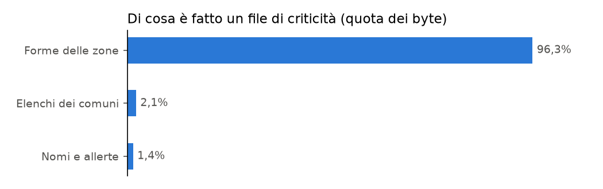

# I bollettini di allerta del DPC come dati aperti: un modello più leggero

**Webysther Sperandio** · Versione 1 · 16 novembre 2026 ·
[English version](en.md)

*Uno studio dei dati aperti dei bollettini nazionali del Dipartimento della
Protezione Civile (DPC), con una proposta.*

Ogni numero di questo documento è misurato da [`measure.py`](measure.py), che
chiunque può eseguire di nuovo; i risultati sono in
[`results.json`](results.json). Le misure riguardano i bollettini pubblicati
fino al 15 novembre 2026.

## Sintesi

Ogni pomeriggio il DPC pubblica due bollettini per tutta l'Italia: il
**bollettino di criticità idrogeologica e idraulica** (il livello di allerta
di ogni zona di allerta per il rischio idraulico, temporali e idrogeologico,
per oggi e domani) e il **bollettino di vigilanza meteorologica** (i
quantitativi di precipitazione previsti per ogni zona di vigilanza e i
fenomeni significativi, per tre giorni). Sono dati aperti, sotto licenza
CC BY 4.0, in GeoJSON e in altri formati.

- Un giorno dei due bollettini occupa **19,3 MB** di GeoJSON. Le allerte vere
  e proprie ne occupano pochi kilobyte: il **96%** di un file di criticità è
  la forma delle zone, uguale ogni giorno.
- La stessa informazione in codici numerici occupa **15,3 kB** di JSON,
  **1.259 volte meno** (4,0 kB compressi, 1.894 volte meno del GeoJSON
  compresso). I 189 bollettini da luglio a settembre 2026 occupano 1,1 MB in
  JSON Lines, contro 1,83 GB di GeoJSON. Le forme
  e i comuni vanno in un riferimento pubblicato solo quando cambiano: le forme
  sono cambiate in 8 dei 2.571 bollettini misurati dal 2020, e il riferimento
  avrebbe avuto 15 versioni.
- Ogni valore dei bollettini appartiene a un piccolo insieme chiuso. In 2.572
  bollettini dal 2020, i testi in italiano sono quattro criticità e tre rischi,
  e ogni criticità ha sempre lo stesso livello di allerta. Possono diventare
  codici numerici, che qualsiasi applicazione può esprimere in qualsiasi
  lingua.
- I file hanno difetti che un modello a codici evita: caratteri persi per
  errori di codifica in ogni file, il nome di una zona troncato a 150 byte,
  elenchi di comuni cresciuti a ogni bollettino fino a 748.705 nomi ripetuti,
  bollettini senza comuni, due grafie degli stessi campi, zone rinominate
  senza un identificativo stabile, e coordinate con 15 decimali dove 6
  bastano.

La proposta: mantenere i file attuali e pubblicare accanto a essi un
riferimento delle zone con versioni (con codici stabili e i codici ISTAT dei
comuni) e, per ogni bollettino, un piccolo documento JSON di codici
numerici, secondo il [dizionario dei dati](../data-dictionary.xlsx).

## 1. Disegno della ricerca

### 1.1 Design science

Lo studio segue la design science research, che costruisce un artefatto per
risolvere un problema rilevante e lo valuta con rigore (Hevner et al., 2004),
nelle sei attività della design science research methodology (Peffers et al.,
2007). L'artefatto è un modello dei dati, con la sua prova di fattibilità; il
contributo è il miglioramento di un problema noto con una soluzione nuova
(Gregor & Hevner, 2013).

| Attività (Peffers et al., 2007) | In questo studio |
|---|---|
| Identificazione del problema e motivazione | Sezioni da 2 a 6: dimensione, ridondanza, testi solo in italiano, difetti |
| Obiettivi della soluzione | Sezione 7: più leggera, in nessuna lingua, con identificativi stabili, senza rompere i file attuali |
| Progettazione e sviluppo | Il dizionario dei dati, i documenti giornalieri di codici, il riferimento delle zone, la loro implementazione in aiodpc |
| Dimostrazione | Sezione 9: la prova di fattibilità su un bollettino fissato, e un trimestre di bollettini in JSON Lines |
| Valutazione | Sezione 8, misurata; e i test di aiodpc (707 test, copertura completa; le etichette italiane restituiscono ogni testo del DPC) |
| Comunicazione | Questo studio, in italiano e in inglese, con il suo codice e i suoi dati |

### 1.2 Modello di qualità dei dati

I difetti sono classificati con il modello di qualità dei dati della ISO/IEC
25012 (ISO/IEC, 2008), le cui caratteristiche si misurano come nella ISO/IEC
25024 (ISO/IEC, 2015). È il modello che le linee guida italiane sui dati
aperti raccomandano alle pubbliche amministrazioni per la qualità dei loro
dati (AgID, 2023, paragrafo 5.3). Il modello estende le dimensioni della
qualità dei dati di Wang e Strong (1996), ed è stato applicato ai dati aperti
della pubblica amministrazione italiana (Vetrò et al., 2016).

### 1.3 Dati e campionamento

- **Censimento dei riepiloghi**: il file di riepilogo di ogni bollettino di
  criticità pubblicato dal 1° gennaio 2020 al 15 novembre 2026, 2.572 in
  tutto.
- **Censimento delle zone**: il file GeoJSON di criticità del giorno di
  ciascuno di quei bollettini, 2.571 file e 15,2 GB (un bollettino non ne ha).
  Ogni file è letto mentre viene scaricato e non è conservato: ne restano, per
  ogni zona, un'impronta (SHA-256) della sua forma e del suo insieme di
  comuni, e per ogni file il numero dei suoi nomi danneggiati e ripetuti.
- **Campione ragionato**: 73 file GeoJSON di criticità (12.250 zone-giorno),
  estratti a caso (seme 7) all'interno di tre strati di giorni di bollettino
  scelti per la varietà dei loro testi: con allerta rossa, con allerta
  arancione, con più rischi allo stesso livello. Il campionamento ragionato
  sceglie i casi più informativi per la domanda e non rappresenta l'intera
  popolazione (Etikan et al., 2016); la sezione 10 ne discute le conseguenze.
- **Un giorno completo**: gli otto file del 15 novembre 2026.
- **Triangolazione** (Denzin, 1978): l'insieme chiuso dei testi si ritrova sia
  nei riepiloghi sia nelle zone del campione; il difetto di codifica è misurato
  nei file e segnalato in modo indipendente sul repository del DPC
  ([issue #10](https://github.com/pcm-dpc/DPC-Bollettini-Criticita-Idrogeologica-Idraulica/issues/10)).

### 1.4 Riproducibilità computazionale

Lo studio segue le regole della ricerca computazionale riproducibile (Sandve
et al., 2013; Peng, 2011):

- ogni numero viene da un solo script, [`measure.py`](measure.py), ed è
  scritto in [`results.json`](results.json); un controllo confronta ogni
  numero del testo con esso;
- i dati di ingresso sono fissati: l'ultimo giorno misurato, il bollettino del
  giorno misurato per intero e il seme del campione sono costanti dello script,
  e i file del DPC restano pubblicati;
- nulla è modificato a mano tra i dati e le figure, che lo script disegna;
- il codice, le sue versioni e i test sono pubblici, nel repository di aiodpc.

Per eseguirlo di nuovo:

```bash
pip install --editable . --group docs
python docs/study/measure.py CACHE_DIR
```

Scarica circa 450 MB in `CACHE_DIR`, legge altri 15,2 GB per il censimento
delle zone conservandone solo le impronte, e restituisce gli stessi
numeri, tranne le
dimensioni dei repository, che crescono ogni giorno, e i tempi di lettura, che
dipendono dalla macchina.

## 2. Cosa pubblica il DPC

I bollettini sono pubblicati su
[mappe.protezionecivile.gov.it](https://mappe.protezionecivile.gov.it/) e in
due repository GitHub,
[DPC-Bollettini-Criticita-Idrogeologica-Idraulica](https://github.com/pcm-dpc/DPC-Bollettini-Criticita-Idrogeologica-Idraulica)
e
[DPC-Bollettini-Vigilanza-Meteorologica](https://github.com/pcm-dpc/DPC-Bollettini-Vigilanza-Meteorologica).

| Bollettino | File al giorno (GeoJSON) | Dimensione | Elementi |
|---|---|---|---|
| Criticità | oggi, domani | 2 × 5,53 MB | 187 zone di allerta |
| Vigilanza, zone | oggi, domani, dopodomani | 3 × 2,72 MB | 71 zone di vigilanza |
| Vigilanza, fenomeni | oggi, domani, dopodomani | da 0,02 a 0,03 MB | da 63 a 91 punti |
| **Un giorno** | **8 file** | **19,3 MB** (7,6 MB compressi) | |

Misure sui bollettini del 15 novembre 2026 (criticità `20261115_1421`,
vigilanza `20261115`). Il repository della criticità conta 2.572 bollettini
dal 1° gennaio 2020 al 15 novembre 2026, in 2.511 giorni: in 58 giorni il DPC
ha pubblicato un aggiornamento. I repository conservano ogni giorno da allora,
in più formati (GeoJSON, TopoJSON, shapefile, XML, PDF e immagini): pesano
6,6 GB e 12,9 GB (GitHub, 16 novembre 2026).

Ogni zona di un file di criticità riporta il nome (`Nome zona`), i comuni per
nome (`Comuni`), la forma e quattro testi:

```json
"Rappresentata nella mappa": "Ordinaria per rischio idrogeologico / ALLERTA GIALLA",
"Per rischio idraulico": "Assenza di fenomeni significativi prevedibili / NESSUNA ALLERTA",
"Per rischio temporali": "Assenza di fenomeni significativi prevedibili / NESSUNA ALLERTA",
"Per rischio idrogeologico": "Ordinaria / ALLERTA GIALLA"
```

Una zona di vigilanza riporta il nome (`Nome_Zona`), i comuni (`comuni`), la
forma, la classe dei quantitativi previsti (`id_classificazione`, un numero)
e il suo testo (`Quantitativi_previsti`). Un fenomeno è un punto con un codice
(`id_fenomeno`, un numero).

## 3. Di cosa sono fatti i file



| File | Forme delle zone | Elenchi dei comuni | Nomi e allerte |
|---|---|---|---|
| Criticità | 96,3% | 2,1% | 1,4% |
| Vigilanza, zone | 93,8% | 5,6% | 0,3% |

Il bollettino vero e proprio, ciò che cambia da un giorno all'altro, è tra lo
0,3% e l'1,4% di un file di zone. I file dei fenomeni sono già piccoli (da 20
a 29 kB).

Le coordinate delle forme della criticità hanno fino a 15 decimali, quelle
della vigilanza fino a 8. La specifica GeoJSON osserva che 6 decimali
corrispondono a circa 10 cm (Butler et al., 2016, sezione 11.2): con 6, le
forme della criticità sono più leggere del 44,4% e le forme di un giorno del
32,3% (12,4 MB invece di 18,3 MB), senza cambiare formato.

## 4. Le zone cambiano di rado


Il censimento confronta le zone di ogni bollettino con quelle del precedente,
dal 1° gennaio 2020 al 15 novembre 2026.

- **Le forme sono le stesse da un bollettino all'altro.** Su 435.235
  confronti di una zona con la stessa zona nel bollettino precedente, 434.860
  (99,9%) trovano la stessa forma. Le forme sono cambiate in modo duraturo in
  8 bollettini: 10 febbraio 2020 (6 zone), 10 dicembre 2020 (8), 26 aprile
  2021 (14), 15 maggio 2021 (13), 23 maggio 2023 (20), 26 maggio 2023 (146 su
  170), 20 novembre 2025 (16) e 1° giugno 2026 (148 delle 161 zone rimaste).
- **L'insieme delle zone è cambiato cinque volte:** "Roma" è diventata
  "Bacini di Roma" il 10 febbraio 2020; le 158 zone sono diventate 168 l'11
  dicembre 2020 (18 aggiunte, 8 tolte, il giorno dopo che le 8 zone tolte
  avevano cambiato forma), e 170 il 15 maggio 2021 (3 aggiunte, 1 tolta);
  quattro zone sono state rinominate il 23 maggio 2023; e dal 1° giugno 2026
  le zone sono 187 (26 aggiunte, 9 tolte).
- **Le zone vengono rinominate senza un identificativo stabile.** "Nodo
  idraulico di Milano" è diventato "Nodo Idraulico di Milano" (una maiuscola)
  il 15 maggio 2021; "Pianura bolognese di Reno e suoi affluenti" è diventato
  "Pianura bolognese" il 23 maggio 2023. Confrontare le zone per nome tra
  bollettini diversi non funziona più a ogni cambiamento.
- **Un riferimento delle zone avrebbe avuto 15 versioni.** Contando ogni
  cambiamento dei nomi, delle forme e degli insiemi di comuni, le zone dei
  2.571 bollettini si presentano in 15 versioni. Uno dei 14 cambiamenti è
  soltanto l'errore di codifica della sezione 6 che raggiunge i nomi dei
  comuni (8 maggio 2024).
- **Alcuni bollettini si guastano, e il successivo li ripara.** L'11 maggio
  2023 due zone della Sicilia hanno cambiato forma per un solo bollettino e
  sono tornate come prima il giorno dopo; sei bollettini non elencano nessun
  comune (sezione 6). Un cambiamento che il bollettino successivo annulla è
  contato come un difetto di quel bollettino, non come una versione delle
  zone.

Pubblicare le forme ogni giorno invia di nuovo gli stessi 5,3 MB di forme
della criticità e 2,6 MB di forme della vigilanza: 18,3 dei 19,3 MB di un
giorno.

## 5. Ogni valore appartiene a un insieme chiuso

I riepiloghi HTML di tutti i 2.572 bollettini, e ogni zona del campione, usano
solo questi testi:

| Criticità | Allerta | Rischi |
|---|---|---|
| Assenza di fenomeni significativi prevedibili | NESSUNA ALLERTA (verde) | nessuno |
| Ordinaria | ALLERTA GIALLA | idraulico, temporali, idrogeologico |
| Moderata | ALLERTA ARANCIONE | idraulico, temporali, idrogeologico |
| Elevata | ALLERTA ROSSA | idraulico, idrogeologico |

- Ogni criticità ha sempre lo stesso livello di allerta: le quattro coppie
  della tabella sono le sole in 12.250 zone-giorno.
- Il riepilogo di una zona (`Rappresentata nella mappa`) nomina un solo
  rischio, quello mostrato dalla mappa, anche quando altri rischi hanno lo
  stesso livello.
- Nel periodo il DPC non ha mai pubblicato un'allerta rossa per temporali.
- I quantitativi del bollettino di vigilanza sono già una classe (da 1 a 5), e
  i fenomeni hanno già un codice (24 nella legenda del DPC).

Un testo che è sempre uno di pochi valori è un codice scritto a parole, e in
una sola lingua. In numeri, ogni valore è un codice; un elenco dei codici ne
dà l'etichetta in italiano, e in qualsiasi lingua. aiodpc lo fa oggi in 13
lingue.

## 6. Difetti, per caratteristica di qualità

Le caratteristiche sono quelle della ISO/IEC 25012 (sezione 1.2).

| Caratteristica | Difetto | Misura |
|---|---|---|
| Accuratezza | Caratteri persi per errori di codifica | Un "?" al posto di una lettera in tutti i 2.571 bollettini: "Valle d?Aosta" (Valle d’Aosta), "Savogna d'Isonzo-Sovodnje ob So?i" (Soči). In ogni bollettino con i comuni dall'8 maggio 2024 al 19 novembre 2025 (568), anche un "�" al posto delle lettere accentate di fino a 158 comuni: "F�nis" (Fénis), "Carr�" (Carrù). Segnalato sul repository del DPC nel 2024 ([issue #10](https://github.com/pcm-dpc/DPC-Bollettini-Criticita-Idrogeologica-Idraulica/issues/10)); il bollettino del 20 novembre 2025 ha corretto i "�", non i "?", che un commento di ottobre 2026 segnala di nuovo |
| Accuratezza | Il nome di una zona troncato | Dal 1° giugno 2026, "…Valle di Champorcher e Valle di Gressoney" è "…Valle di Gresso": 146 caratteri, esattamente 150 byte con i suoi due apostrofi tipografici, il che fa pensare a un campo di 150 byte |
| Coerenza | Comuni ripetuti | 686 dei 2.571 bollettini ripetono i nomi. Fino ad agosto 2021 ogni bollettino aggiunge una copia di ogni elenco (da 8.182 a 8.215 nomi) a quelle del bollettino precedente, finché uno non riparte da una copia sola: il file del 31 marzo 2020 contiene 748.705 nomi ripetuti e pesa 15,9 MB, il più grande del censimento. Dal 2022 le ripetizioni tornano in bollettini isolati, da 17 a 28 l'anno fino al 2025 e 7 nel 2026, ciascuno con da una a sette copie in più degli elenchi (da 8.182 a 57.309 nomi) |
| Completezza | Comuni mancanti | Sei bollettini non hanno `Comuni` in nessuna zona (9 aprile, 5 maggio, 11 maggio e 31 ottobre 2023, 11 marzo 2024, 26 luglio 2025); tre di maggio 2021 non li hanno in due zone |
| Completezza | Un bollettino senza file | Il bollettino `20200929_1425` ha solo il file di stile, nessun GeoJSON per nessuno dei due giorni |
| Coerenza | Due grafie dello stesso campo | `Nome zona` e `Comuni` nei file di criticità, `Nome_Zona` e `comuni` in quelli di vigilanza |
| Coerenza | Due lingue nei nomi dei file | `_today`, `_tomorrow` per i file di criticità; `_oggi`, `_domani`, `_dopodomani` per quelli di vigilanza e per le immagini di anteprima di entrambi |
| Tracciabilità | Zone senza identificativo | Le zone sono note solo per nome, e vengono rinominate (sezione 4) |
| Accuratezza | Comuni solo per nome | Sette nomi (Peglio, Livo, Samone, Castro, San Teodoro, Calliano, Valverde) appartengono ciascuno a due comuni lontani; "Bolzano/Bozen" in un bollettino è "Bolzano" nell'altro |
| Efficienza | Dati statici pubblicati ogni giorno | 18,3 dei 19,3 MB di un giorno sono forme cambiate in 8 bollettini su 2.571 (sezione 4) |
| Efficienza | Precisione superflua | Coordinate con 15 decimali; 6 corrispondono a circa 10 cm (sezione 3) |
| Conformità | Una data con fuso orario | `data_bollettino` è "2026-11-15Z", non una data ISO 8601 |
| Completezza | Un campo vuoto | `id` è vuoto in tutti i fenomeni dei file del 15 novembre 2026 |

## 7. La proposta

Mantenere i file attuali, perché nessuna applicazione smetta di funzionare, e
pubblicare accanto a essi:

1. **Un riferimento delle zone, con versioni.** Un file delle zone di allerta
   e uno delle zone di vigilanza, ognuno con un codice stabile per zona, il
   nome, la forma e i codici ISTAT dei comuni (l'ISTAT li pubblica con la loro
   storia), ognuno una sola volta. Una nuova versione solo quando le zone
   cambiano, con la data da cui vale; le versioni precedenti restano
   disponibili.
2. **Un piccolo documento JSON di codici per ogni bollettino**, che indica la
   versione delle zone che usa, con una riga di codici per zona e giorno:
   - criticità: giorno, codice della zona, livello di allerta della zona,
     rischio mostrato nella mappa, livello di allerta di ognuno dei tre
     rischi;
   - vigilanza: giorno, codice della zona, classe dei quantitativi previsti;
     e i fenomeni: giorno, codice del fenomeno, latitudine, longitudine.
3. **Gli elenchi dei codici**, con le etichette in italiano: il
   [dizionario dei dati](../data-dictionary.xlsx) ne propone uno, che mantiene
   i codici già pubblicati dal DPC (`id_classificazione`, `id_fenomeno`).

Seguono le Data on the Web Best Practices del W3C (Lóscio et al., 2017):
identificativi persistenti, dati con versioni, vocabolari standard, metadati
che descrivono la struttura. I documenti sono JSON (Bray, 2017), il formato
che il DPC già pubblica, e la loro struttura può essere descritta da uno JSON
Schema (Pezoa et al., 2016). Ogni documento sta su una riga, quindi i
documenti di un periodo, uno per riga, formano un file JSON Lines: la storia
dei bollettini in un solo file, che cresce di una riga per bollettino.
Identificativi stabili
ed elenchi di codici condivisi rendono i dati anche interoperabili e
riutilizzabili nel senso dei principi FAIR (Wilkinson et al., 2016).

Alcune correzioni sono utili anche nei file attuali: UTF-8 ovunque, nessun
limite che tronchi i nomi, la stessa grafia dei campi nei due bollettini,
coordinate con 6 decimali, e date in ISO 8601 (`2026-11-15`).

La criticità non richiede una colonna propria: in ogni bollettino misurato
deriva dal livello di allerta. Può essere mantenuta per chiarezza.

## 8. Cosa si risparmia


| | GeoJSON oggi | Codici | Rapporto |
|---|---|---|---|
| Un giorno | 19,3 MB | 15,3 kB | 1.259× |
| Un giorno, compresso (gzip) | 7,6 MB | 4,0 kB | 1.894× |
| Un trimestre (2026-Q3, 189 bollettini) | 1,83 GB | 1,1 MB | 1.639× |
| Un anno (365 giorni) | 7,0 GB | 5,6 MB | |
| Lettura di un giorno (JSON, in Python) | circa 0,4 s | 0,3 ms | oltre 1.000× |

Il riferimento delle zone pesa 5,3 MB (zone di allerta) e 2,6 MB (zone di
vigilanza) in GeoJSON, e 124 kB e 155 kB come tabelle di nomi e comuni; si
scarica una volta per versione. I tempi di lettura sono misurati su una sola
macchina e indicano solo l'ordine di grandezza.

Oltre ai byte:

- **Qualsiasi lingua.** Un codice si esprime in qualsiasi lingua da un elenco
  di etichette; i testi in italiano del DPC diventano uno di questi elenchi.
- **Meno errori.** Le applicazioni confrontano numeri invece di interpretare
  frasi in italiano, la cui forma (maiuscole, apostrofi, "criticità" o no)
  cambia tra i file e i riepiloghi.
- **Storia.** Un anno dei due bollettini sta in circa 6 MB: la storia delle
  allerte di una zona, o di tutto il Paese, diventa semplice da studiare.
- **Dispositivi piccoli.** Un sensore, un telefono con una connessione debole
  o un sistema di domotica possono seguire le allerte senza scaricare
  megabyte ogni giorno.

## 9. Prova di fattibilità

[aiodpc](https://github.com/webysther/aiodpc), un client Python open source dei
bollettini del DPC, produce questi file da quelli attuali. Gli stessi codici
sono nel suo dizionario dei dati.

```python
import asyncio
import json

from aiodpc import DpcClient


async def main() -> None:
    async with DpcClient() as dpc:
        criticality = await dpc.get_criticality_map(
            bulletin_id="20261115_1421", skip_expired=False
        )
        vigilance = await dpc.get_vigilance_map(
            bulletin_id="20261115", skip_expired=False
        )

    # One JSON document per bulletin, on one line: a line of JSON Lines
    for bulletin in (criticality.compact(), vigilance.compact()):
        line = bulletin.to_json()
        document = json.loads(line)
        size = f"{len(line.encode()):,} bytes"
        print(document["bulletin"], "zone set", document["zone_set"], size)
        print(" ", document["columns"])
        print(" ", document["rows"][:3])
    print(" ", document["phenomena"]["columns"])
    print(" ", document["phenomena"]["rows"][:2])


asyncio.run(main())
```

```text
20261115_1421 zone set 68bcac32826e 7,454 bytes
  ['day', 'zone', 'level', 'criticality', 'mapped_risk', 'hydraulic', 'thunderstorms', 'hydrogeological']
  [[0, 28, 1, 1, 0, 1, 1, 1], [0, 39, 1, 1, 0, 1, 1, 1], [0, 37, 1, 1, 0, 1, 1, 1]]
20261115 zone set d124f4a6cd97 7,874 bytes
  ['day', 'zone', 'precipitation']
  [[0, 43, 1], [0, 27, 1], [0, 45, 1]]
  ['day', 'code', 'latitude', 'longitude']
  [[0, 5, 45.82818, 7.08536], [0, 5, 44.98053, 6.76341]]
```

La tabella delle zone di ogni insieme di zone (`zones.to_json()`) dà il nome
e i comuni di ogni codice di zona, e `zones.to_geojson()` la sua forma.

Il repository di aiodpc contiene un intero trimestre in questa forma
([`data/2026-Q3`](../../data/2026-Q3)): i 97 bollettini di criticità e i 92
di vigilanza da luglio a settembre 2026, uno per riga in due file JSON Lines,
occupano 1,1 MB (101 kB compressi), contro 1,83 GB nei 746 file del DPC degli
stessi bollettini, 1.639 volte meno. Tutti i bollettini del trimestre usano un
solo insieme di zone per tipo; i due riferimenti aggiungono 8,2 MB, una volta
sola. Il suo [README](../../data/README.md) lo legge con pandas e DuckDB.

Poiché il DPC non pubblica codici delle zone, aiodpc numera le zone secondo il
loro nome in ordine alfabetico e identifica l'insieme delle zone con
un'impronta (`zone set`): i codici valgono finché le zone non cambiano. Codici
stabili del DPC varrebbero anche attraverso i cambiamenti.

## 10. Minacce alla validità

Secondo Wohlin et al. (2012) e Runeson e Höst (2009):

- **Validità di costrutto.** La dimensione è quella in byte dei file come sono
  pubblicati, non compressi e compressi; ciò che viaggia in rete dipende dal
  server, quindi si riportano entrambe. "La stessa informazione" significa
  ogni valore delle allerte e dei fenomeni: i testi in italiano non sono
  conservati come testo, ma sono un insieme chiuso (sezione 5) che i codici
  restituiscono, come verificano i test di aiodpc. Le zone sono confrontate per
  nome, quindi una zona rinominata conta come una tolta e una aggiunta. Due
  forme sono le stesse quando lo sono le impronte del loro JSON, con le chiavi
  ordinate: punti in un altro ordine o con altri decimali contano come un
  cambiamento. Un cambiamento che il bollettino successivo annulla conta come
  un difetto, non come una versione delle zone.
- **Validità interna.** Le misure vengono da uno script, che potrebbe essere
  sbagliato. La lettura dei dati è testata (707 test, copertura completa), ogni
  numero del testo è confrontato con `results.json`, e la misura ha corretto
  risultati delle prime stesure. Un apparente cambio di ordine degli elenchi
  dei comuni erano in realtà i nomi ripetuti della sezione 6. Il censimento
  delle zone ha poi corretto il campione: ha datato al bollettino i
  cambiamenti che il campione collocava fino a quattro mesi e mezzo dopo, ha
  trovato quelli di febbraio 2020, precedenti al primo file del campione, ha
  trovato i "�" che la misura del campione non cercava, e ripetizioni nel
  2026, in bollettini che il campione non aveva estratto. Il metodo del
  censimento è stato prima verificato sui bollettini dal 9 novembre 2025 al
  18 gennaio 2026, rispetto ai file del campione di quel periodo e a un
  confronto diretto delle forme.
- **Validità esterna.** Il campione privilegia i giorni con allerte, quindi le
  frequenze dei suoi testi non sono quelle di tutti i giorni; l'insieme chiuso
  si basa sul censimento dei riepiloghi. Il censimento delle zone legge un
  file per bollettino, quello del giorno: i file del giorno successivo, la
  storia della vigilanza e i file TopoJSON, shapefile, XML e PDF non sono
  stati misurati. I risultati descrivono i file fino al 15 novembre 2026; il
  DPC può cambiarli, e può sostituire file già pubblicati.
- **Validità delle conclusioni e affidabilità.** I risultati sono conteggi e
  dimensioni, non stime, quindi non richiedono inferenza statistica. Chiunque
  può ripeterli con lo script e gli stessi dati di ingresso (sezione 1.4); i
  tempi di lettura sono l'unica misura che dipende dalla macchina.

## 11. Come citare

Sperandio, W. (2026). *I bollettini di allerta del DPC come dati aperti: un
modello più leggero* (Versione 1).
https://github.com/webysther/aiodpc/blob/main/docs/study/it.md

```bibtex
@misc{sperandio2026dpc-it,
  author       = {Sperandio, Webysther},
  title        = {I bollettini di allerta del {DPC} come dati aperti: un modello più leggero},
  year         = {2026},
  month        = nov,
  note         = {Versione 1. English version: docs/study/en.md},
  howpublished = {\url{https://github.com/webysther/aiodpc/blob/main/docs/study/it.md}}
}
```

Il file [`CITATION.cff`](../../CITATION.cff) del repository riporta lo stesso
in altri formati ("Cite this repository" su GitHub).

## Crediti

- **Autore**: Webysther Sperandio.
- **Dati**: © Dipartimento della Protezione Civile – Presidenza del Consiglio
  dei Ministri, sotto licenza
  [CC BY 4.0](https://creativecommons.org/licenses/by/4.0/).
- **Software**: [aiodpc](https://github.com/webysther/aiodpc), licenza MIT.

Questo studio non è affiliato al DPC. Le correzioni sono benvenute come
[issue di aiodpc](https://github.com/webysther/aiodpc/issues).

## Bibliografia

- AgID. (2023). *Linee guida recanti regole tecniche per l'apertura dei dati e
  il riutilizzo dell'informazione del settore pubblico* (v. 1.0, Determinazione
  n. 183/2023). Agenzia per l'Italia Digitale.
  https://www.agid.gov.it/sites/default/files/repository_files/lg-open-data_v.1.0_1.pdf
- Bray, T. (Ed.). (2017). *The JavaScript Object Notation (JSON) data
  interchange format* (RFC 8259). IETF. https://doi.org/10.17487/RFC8259
- Butler, H., Daly, M., Doyle, A., Gillies, S., Hagen, S., & Schaub, T. (2016).
  *The GeoJSON format* (RFC 7946). IETF. https://doi.org/10.17487/RFC7946
- Denzin, N. K. (1978). *The research act: A theoretical introduction to
  sociological methods* (2nd ed.). McGraw-Hill.
- Etikan, I., Musa, S. A., & Alkassim, R. S. (2016). Comparison of convenience
  sampling and purposive sampling. *American Journal of Theoretical and Applied
  Statistics, 5*(1), 1–4. https://doi.org/10.11648/j.ajtas.20160501.11
- Gregor, S., & Hevner, A. R. (2013). Positioning and presenting design science
  research for maximum impact. *MIS Quarterly, 37*(2), 337–355.
  https://doi.org/10.25300/MISQ/2013/37.2.01
- Hevner, A. R., March, S. T., Park, J., & Ram, S. (2004). Design science in
  information systems research. *MIS Quarterly, 28*(1), 75–105.
  https://doi.org/10.2307/25148625
- ISO/IEC. (2008). *ISO/IEC 25012:2008. Software engineering — Software product
  Quality Requirements and Evaluation (SQuaRE) — Data quality model*.
- ISO/IEC. (2015). *ISO/IEC 25024:2015. Systems and software engineering —
  Systems and software Quality Requirements and Evaluation (SQuaRE) —
  Measurement of data quality*.
- Lóscio, B. F., Burle, C., & Calegari, N. (Eds.). (2017). *Data on the Web
  best practices* (W3C Recommendation). https://www.w3.org/TR/dwbp/
- Peffers, K., Tuunanen, T., Rothenberger, M. A., & Chatterjee, S. (2007). A
  design science research methodology for information systems research.
  *Journal of Management Information Systems, 24*(3), 45–77.
  https://doi.org/10.2753/MIS0742-1222240302
- Peng, R. D. (2011). Reproducible research in computational science.
  *Science, 334*(6060), 1226–1227. https://doi.org/10.1126/science.1213847
- Pezoa, F., Reutter, J. L., Suarez, F., Ugarte, M., & Vrgoč, D. (2016).
  Foundations of JSON Schema. In *Proceedings of the 25th International
  Conference on World Wide Web* (pp. 263–273).
  https://doi.org/10.1145/2872427.2883029
- Runeson, P., & Höst, M. (2009). Guidelines for conducting and reporting case
  study research in software engineering. *Empirical Software Engineering,
  14*(2), 131–164. https://doi.org/10.1007/s10664-008-9102-8
- Sandve, G. K., Nekrutenko, A., Taylor, J., & Hovig, E. (2013). Ten simple
  rules for reproducible computational research. *PLoS Computational Biology,
  9*(10), e1003285. https://doi.org/10.1371/journal.pcbi.1003285
- Vetrò, A., Canova, L., Torchiano, M., Orozco Minotas, C., Iemma, R., &
  Morando, F. (2016). Open data quality measurement framework: Definition and
  application to Open Government Data. *Government Information Quarterly,
  33*(2), 325–337. https://doi.org/10.1016/j.giq.2016.02.001
- Wang, R. Y., & Strong, D. M. (1996). Beyond accuracy: What data quality means
  to data consumers. *Journal of Management Information Systems, 12*(4), 5–33.
  https://doi.org/10.1080/07421222.1996.11518099
- Wilkinson, M. D., Dumontier, M., Aalbersberg, I. J., et al. (2016). The FAIR
  guiding principles for scientific data management and stewardship.
  *Scientific Data, 3*, 160018. https://doi.org/10.1038/sdata.2016.18
- Wohlin, C., Runeson, P., Höst, M., Ohlsson, M. C., Regnell, B., & Wesslén, A.
  (2012). *Experimentation in software engineering*. Springer.
  https://doi.org/10.1007/978-3-642-29044-2
