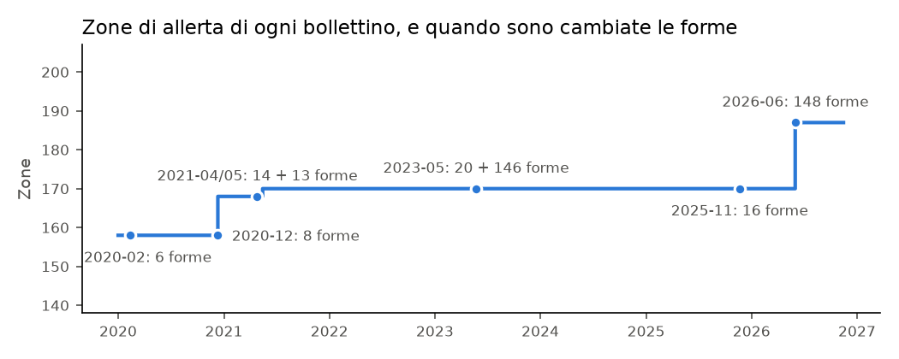
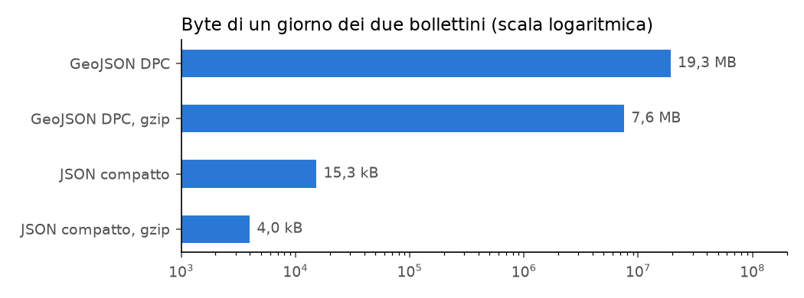

# I bollettini di allerta del DPC come dati aperti: un modello più leggero

**Webysther Sperandio** · Versione 1 · 16 novembre 2026 ·
[English version](en.md)

*Uno studio dei dati aperti dei bollettini nazionali del Dipartimento della
Protezione Civile (DPC), con una proposta.*

Ogni numero di questo documento è misurato da [`measure.py`](measure.py), che
chiunque può eseguire di nuovo; i risultati sono in
[`results.json`](results.json). Le misure riguardano i bollettini pubblicati
fino al 15 novembre 2026.

## Sintesi

Ogni pomeriggio il DPC pubblica due bollettini per tutta l'Italia: il
**bollettino di criticità idrogeologica e idraulica** (il livello di allerta
di ogni zona di allerta per il rischio idraulico, temporali e idrogeologico,
per oggi e domani) e il **bollettino di vigilanza meteorologica** (i
quantitativi di precipitazione previsti per ogni zona di vigilanza e i
fenomeni significativi, per tre giorni). Sono dati aperti, sotto licenza
CC BY 4.0, in GeoJSON e in altri formati.

- Un giorno dei due bollettini occupa **19,3 MB** di GeoJSON. Le allerte vere
  e proprie ne occupano pochi kilobyte: il **96%** di un file di criticità è
  la forma delle zone, uguale ogni giorno.
- La stessa informazione in codici numerici occupa **13,4 kB**, **1.438 volte
  meno** (3,8 kB compressi, 2.012 volte meno del GeoJSON compresso). Le forme
  e i comuni vanno in un riferimento pubblicato solo quando cambiano: cinque
  volte nei sei anni misurati.
- Ogni valore dei bollettini appartiene a un piccolo insieme chiuso. In 2.572
  bollettini dal 2020, i testi in italiano sono quattro criticità e tre rischi,
  e ogni criticità ha sempre lo stesso livello di allerta. Possono diventare
  codici numerici, che qualsiasi applicazione può esprimere in qualsiasi
  lingua.
- I file hanno difetti che un modello a codici evita: caratteri persi per un
  errore di codifica in ogni file, il nome di una zona troncato a 150 byte,
  elenchi di comuni che ripetono i nomi fino a 62 volte (dal 2020 al 2024),
  due grafie degli stessi campi, zone rinominate senza un identificativo
  stabile, e coordinate con 15 decimali dove 6 bastano.

La proposta: mantenere i file attuali e pubblicare accanto a essi un
riferimento delle zone con versioni (con codici stabili e i codici ISTAT dei
comuni) e tre piccoli file giornalieri di codici numerici, secondo il
[dizionario dei dati](../data-dictionary.xlsx).

## 1. Disegno della ricerca

### 1.1 Design science

Lo studio segue la design science research, che costruisce un artefatto per
risolvere un problema rilevante e lo valuta con rigore (Hevner et al., 2004),
nelle sei attività della design science research methodology (Peffers et al.,
2007). L'artefatto è un modello dei dati, con la sua prova di fattibilità; il
contributo è il miglioramento di un problema noto con una soluzione nuova
(Gregor & Hevner, 2013).

| Attività (Peffers et al., 2007) | In questo studio |
|---|---|
| Identificazione del problema e motivazione | Sezioni da 2 a 6: dimensione, ridondanza, testi solo in italiano, difetti |
| Obiettivi della soluzione | Sezione 7: più leggera, in nessuna lingua, con identificativi stabili, senza rompere i file attuali |
| Progettazione e sviluppo | Il dizionario dei dati, i file giornalieri di codici, il riferimento delle zone, la loro implementazione in aiodpc |
| Dimostrazione | Sezione 9: la prova di fattibilità su un bollettino fissato |
| Valutazione | Sezione 8, misurata; e i test di aiodpc (501 test, copertura completa; le etichette italiane restituiscono ogni testo del DPC) |
| Comunicazione | Questo studio, in italiano e in inglese, con il suo codice e i suoi dati |

### 1.2 Modello di qualità dei dati

I difetti sono classificati con il modello di qualità dei dati della ISO/IEC
25012 (ISO/IEC, 2008), le cui caratteristiche si misurano come nella ISO/IEC
25024 (ISO/IEC, 2015). È il modello che le linee guida italiane sui dati
aperti raccomandano alle pubbliche amministrazioni per la qualità dei loro
dati (AgID, 2023, paragrafo 5.3). Il modello estende le dimensioni della
qualità dei dati di Wang e Strong (1996), ed è stato applicato ai dati aperti
della pubblica amministrazione italiana (Vetrò et al., 2016).

### 1.3 Dati e campionamento

- **Censimento**: il file di riepilogo di ogni bollettino di criticità
  pubblicato dal 1° gennaio 2020 al 15 novembre 2026, 2.572 in tutto.
- **Campione ragionato**: 73 file GeoJSON di criticità (12.250 zone-giorno),
  estratti a caso (seme 7) all'interno di tre strati di giorni di bollettino
  scelti per la varietà dei loro testi: con allerta rossa, con allerta
  arancione, con più rischi allo stesso livello. Il campionamento ragionato
  sceglie i casi più informativi per la domanda e non rappresenta l'intera
  popolazione (Etikan et al., 2016); la sezione 10 ne discute le conseguenze.
- **Un giorno completo**: gli otto file del 15 novembre 2026.
- **Triangolazione** (Denzin, 1978): l'insieme chiuso dei testi si ritrova sia
  nei riepiloghi sia nelle zone del campione; il difetto di codifica è misurato
  nei file e segnalato in modo indipendente sul repository del DPC
  ([issue #10](https://github.com/pcm-dpc/DPC-Bollettini-Criticita-Idrogeologica-Idraulica/issues/10)).

### 1.4 Riproducibilità computazionale

Lo studio segue le regole della ricerca computazionale riproducibile (Sandve
et al., 2013; Peng, 2011):

- ogni numero viene da un solo script, [`measure.py`](measure.py), ed è
  scritto in [`results.json`](results.json); un controllo confronta ogni
  numero del testo con esso;
- i dati di ingresso sono fissati: l'ultimo giorno misurato, il bollettino del
  giorno misurato per intero e il seme del campione sono costanti dello script,
  e i file del DPC restano pubblicati;
- nulla è modificato a mano tra i dati e le figure, che lo script disegna;
- il codice, le sue versioni e i test sono pubblici, nel repository di aiodpc.

Per eseguirlo di nuovo:

```bash
pip install --editable . --group docs
python docs/study/measure.py CACHE_DIR
```

Scarica circa 450 MB in `CACHE_DIR` e restituisce gli stessi numeri, tranne le
dimensioni dei repository, che crescono ogni giorno, e i tempi di lettura, che
dipendono dalla macchina.

## 2. Cosa pubblica il DPC

I bollettini sono pubblicati su
[mappe.protezionecivile.gov.it](https://mappe.protezionecivile.gov.it/) e in
due repository GitHub,
[DPC-Bollettini-Criticita-Idrogeologica-Idraulica](https://github.com/pcm-dpc/DPC-Bollettini-Criticita-Idrogeologica-Idraulica)
e
[DPC-Bollettini-Vigilanza-Meteorologica](https://github.com/pcm-dpc/DPC-Bollettini-Vigilanza-Meteorologica).

| Bollettino | File al giorno (GeoJSON) | Dimensione | Elementi |
|---|---|---|---|
| Criticità | oggi, domani | 2 × 5,53 MB | 187 zone di allerta |
| Vigilanza, zone | oggi, domani, dopodomani | 3 × 2,72 MB | 71 zone di vigilanza |
| Vigilanza, fenomeni | oggi, domani, dopodomani | da 0,02 a 0,03 MB | da 63 a 91 punti |
| **Un giorno** | **8 file** | **19,3 MB** (7,6 MB compressi) | |

Misure sui bollettini del 15 novembre 2026 (criticità `20261115_1421`,
vigilanza `20261115`). Il repository della criticità conta 2.572 bollettini
dal 1° gennaio 2020 al 15 novembre 2026, in 2.511 giorni: in 58 giorni il DPC
ha pubblicato un aggiornamento. I repository conservano ogni giorno da allora,
in più formati (GeoJSON, TopoJSON, shapefile, XML, PDF e immagini): pesano
6,6 GB e 12,9 GB (GitHub, 16 novembre 2026).

Ogni zona di un file di criticità riporta il nome (`Nome zona`), i comuni per
nome (`Comuni`), la forma e quattro testi:

```json
"Rappresentata nella mappa": "Ordinaria per rischio idrogeologico / ALLERTA GIALLA",
"Per rischio idraulico": "Assenza di fenomeni significativi prevedibili / NESSUNA ALLERTA",
"Per rischio temporali": "Assenza di fenomeni significativi prevedibili / NESSUNA ALLERTA",
"Per rischio idrogeologico": "Ordinaria / ALLERTA GIALLA"
```

Una zona di vigilanza riporta il nome (`Nome_Zona`), i comuni (`comuni`), la
forma, la classe dei quantitativi previsti (`id_classificazione`, un numero)
e il suo testo (`Quantitativi_previsti`). Un fenomeno è un punto con un codice
(`id_fenomeno`, un numero).

## 3. Di cosa sono fatti i file


| File | Forme delle zone | Elenchi dei comuni | Nomi e allerte |
|---|---|---|---|
| Criticità | 96,3% | 2,1% | 1,4% |
| Vigilanza, zone | 93,8% | 5,6% | 0,3% |

Il bollettino vero e proprio, ciò che cambia da un giorno all'altro, è tra lo
0,3% e l'1,4% di un file di zone. I file dei fenomeni sono già piccoli (da 20
a 29 kB).

Le coordinate delle forme della criticità hanno fino a 15 decimali, quelle
della vigilanza fino a 8. La specifica GeoJSON osserva che 6 decimali
corrispondono a circa 10 cm (Butler et al., 2016, sezione 11.2): con 6, le
forme della criticità sono più leggere del 44,4% e le forme di un giorno del
32,3% (12,4 MB invece di 18,3 MB), senza cambiare formato.

## 4. Le zone cambiano di rado



- **Le forme sono le stesse da un bollettino all'altro.** Confrontando ogni
  zona con la stessa zona nel file precedente del campione, la forma è
  identica byte per byte in 11.684 confronti su 12.041 (97,0%). Gli altri 357
  cadono in cinque momenti: 2021-04 (14 zone), 2021-07 (13), 2023-05 (166 zone
  su 170), 2026-01 (16) e 2026-08 (148 su 187). Ognuno è datato dal primo file
  del campione che lo mostra: il cambiamento del 2026-01 è avvenuto tra il
  9 novembre 2025 e il 18 gennaio 2026.
- **L'insieme delle zone è cambiato quattro volte:** da 158 zone a 168 nel
  2021-04 (18 aggiunte, 8 tolte), a 170 nel 2021-07, quattro zone rinominate
  nel 2023-05, e 187 zone nel 2026-08 (26 aggiunte, 9 tolte).
- **Le zone vengono rinominate senza un identificativo stabile.** "Nodo
  idraulico di Milano" è diventato "Nodo Idraulico di Milano" (una maiuscola)
  nel 2021-07; "Pianura bolognese di Reno e suoi affluenti" è diventato
  "Pianura bolognese" nel 2023-05. Confrontare le zone per nome tra bollettini
  diversi non funziona più a ogni cambiamento.

Pubblicare le forme ogni giorno invia di nuovo gli stessi 5,3 MB di forme
della criticità e 2,6 MB di forme della vigilanza: 18,3 dei 19,3 MB di un
giorno.

## 5. Ogni valore appartiene a un insieme chiuso

I riepiloghi HTML di tutti i 2.572 bollettini, e ogni zona del campione, usano
solo questi testi:

| Criticità | Allerta | Rischi |
|---|---|---|
| Assenza di fenomeni significativi prevedibili | NESSUNA ALLERTA (verde) | nessuno |
| Ordinaria | ALLERTA GIALLA | idraulico, temporali, idrogeologico |
| Moderata | ALLERTA ARANCIONE | idraulico, temporali, idrogeologico |
| Elevata | ALLERTA ROSSA | idraulico, idrogeologico |

- Ogni criticità ha sempre lo stesso livello di allerta: le quattro coppie
  della tabella sono le sole in 12.250 zone-giorno.
- Il riepilogo di una zona (`Rappresentata nella mappa`) nomina un solo
  rischio, quello mostrato dalla mappa, anche quando altri rischi hanno lo
  stesso livello.
- Nel periodo il DPC non ha mai pubblicato un'allerta rossa per temporali.
- I quantitativi del bollettino di vigilanza sono già una classe (da 1 a 5), e
  i fenomeni hanno già un codice (24 nella legenda del DPC).

Un testo che è sempre uno di pochi valori è un codice scritto a parole, e in
una sola lingua. In numeri, ogni valore è un codice; un elenco dei codici ne
dà l'etichetta in italiano, e in qualsiasi lingua. aiodpc lo fa oggi in sei
lingue.

## 6. Difetti, per caratteristica di qualità

Le caratteristiche sono quelle della ISO/IEC 25012 (sezione 1.2).

| Caratteristica | Difetto | Misura |
|---|---|---|
| Accuratezza | Caratteri persi per un errore di codifica | "Valle d?Aosta" (Valle d’Aosta) in tutti i 73 file del campione; "Savogna d'Isonzo-Sovodnje ob So?i" (Soči) in 19. Segnalato sul repository del DPC nel 2024 ([issue #10](https://github.com/pcm-dpc/DPC-Bollettini-Criticita-Idrogeologica-Idraulica/issues/10)), con lo stesso "d?Aosta" in un commento di ottobre 2026 |
| Accuratezza | Il nome di una zona troncato | Dal 2026-08, "…Valle di Champorcher e Valle di Gressoney" è "…Valle di Gresso": 146 caratteri, esattamente 150 byte con i suoi due apostrofi tipografici, il che fa pensare a un campo di 150 byte |
| Coerenza | Comuni ripetuti | 21 dei 73 file del campione, dal 2020 a febbraio 2024, ripetono i nomi fino a 62 volte: 4.671.290 voci per 598.107 comuni. Un file del 2020 elenca 205.375 nomi per 8.215 comuni. I file del 2026 non hanno ripetizioni |
| Coerenza | Due grafie dello stesso campo | `Nome zona` e `Comuni` nei file di criticità, `Nome_Zona` e `comuni` in quelli di vigilanza |
| Coerenza | Due lingue nei nomi dei file | `_today`, `_tomorrow` per i file di criticità; `_oggi`, `_domani`, `_dopodomani` per quelli di vigilanza e per le immagini di anteprima di entrambi |
| Tracciabilità | Zone senza identificativo | Le zone sono note solo per nome, e vengono rinominate (sezione 4) |
| Accuratezza | Comuni solo per nome | Sette nomi (Peglio, Livo, Samone, Castro, San Teodoro, Calliano, Valverde) appartengono ciascuno a due comuni lontani; "Bolzano/Bozen" in un bollettino è "Bolzano" nell'altro |
| Efficienza | Dati statici pubblicati ogni giorno | 18,3 dei 19,3 MB di un giorno sono forme che cambiano poche volte in sei anni (sezione 4) |
| Efficienza | Precisione superflua | Coordinate con 15 decimali; 6 corrispondono a circa 10 cm (sezione 3) |
| Conformità | Una data con fuso orario | `data_bollettino` è "2026-11-15Z", non una data ISO 8601 |
| Completezza | Un campo vuoto | `id` è vuoto in tutti i fenomeni dei file del 15 novembre 2026 |

La segnalazione originale dell'issue #10 descrive anche lettere accentate
corrotte nei nomi dei comuni; i file GeoJSON del campione non ne hanno.

## 7. La proposta

Mantenere i file attuali, perché nessuna applicazione smetta di funzionare, e
pubblicare accanto a essi:

1. **Un riferimento delle zone, con versioni.** Un file delle zone di allerta
   e uno delle zone di vigilanza, ognuno con un codice stabile per zona, il
   nome, la forma e i codici ISTAT dei comuni (l'ISTAT li pubblica con la loro
   storia), ognuno una sola volta. Una nuova versione solo quando le zone
   cambiano, con la data da cui vale; le versioni precedenti restano
   disponibili.
2. **Tre piccoli file giornalieri di codici**, che indicano la versione delle
   zone che usano:
   - criticità: giorno, codice della zona, livello di allerta della zona,
     rischio mostrato nella mappa, livello di allerta di ognuno dei tre
     rischi;
   - vigilanza: giorno, codice della zona, classe dei quantitativi previsti;
   - fenomeni: giorno, codice del fenomeno, latitudine, longitudine.
3. **Gli elenchi dei codici**, con le etichette in italiano: il
   [dizionario dei dati](../data-dictionary.xlsx) ne propone uno, che mantiene
   i codici già pubblicati dal DPC (`id_classificazione`, `id_fenomeno`).

Seguono le Data on the Web Best Practices del W3C (Lóscio et al., 2017):
identificativi persistenti, dati con versioni, vocabolari standard, metadati
che descrivono la struttura. I file giornalieri possono essere CSV descritti
da metadati CSV on the Web (Tennison & Kellogg, 2015). Identificativi stabili
ed elenchi di codici condivisi rendono i dati anche interoperabili e
riutilizzabili nel senso dei principi FAIR (Wilkinson et al., 2016).

Alcune correzioni sono utili anche nei file attuali: UTF-8 ovunque, nessun
limite che tronchi i nomi, la stessa grafia dei campi nei due bollettini,
coordinate con 6 decimali, e date in ISO 8601 (`2026-11-15`).

La criticità non richiede una colonna propria: in ogni bollettino misurato
deriva dal livello di allerta. Può essere mantenuta per chiarezza.

## 8. Cosa si risparmia



| | GeoJSON oggi | Codici | Rapporto |
|---|---|---|---|
| Un giorno | 19,3 MB | 13,4 kB | 1.438× |
| Un giorno, compresso (gzip) | 7,6 MB | 3,8 kB | 2.012× |
| Un anno (365 giorni) | 7,0 GB | 4,9 MB | |
| Lettura di un giorno (JSON o CSV, in Python) | circa 0,4 s | 0,3 ms | oltre 1.000× |

Il riferimento delle zone pesa 5,3 MB (zone di allerta) e 2,6 MB (zone di
vigilanza) in GeoJSON, e 124 kB e 155 kB come tabelle di nomi e comuni; si
scarica una volta per versione. I tempi di lettura sono misurati su una sola
macchina e indicano solo l'ordine di grandezza.

Oltre ai byte:

- **Qualsiasi lingua.** Un codice si esprime in qualsiasi lingua da un elenco
  di etichette; i testi in italiano del DPC diventano uno di questi elenchi.
- **Meno errori.** Le applicazioni confrontano numeri invece di interpretare
  frasi in italiano, la cui forma (maiuscole, apostrofi, "criticità" o no)
  cambia tra i file e i riepiloghi.
- **Storia.** Un anno dei due bollettini sta in circa 5 MB: la storia delle
  allerte di una zona, o di tutto il Paese, diventa semplice da studiare.
- **Dispositivi piccoli.** Un sensore, un telefono con una connessione debole
  o un sistema di domotica possono seguire le allerte senza scaricare
  megabyte ogni giorno.

## 9. Prova di fattibilità

[aiodpc](https://github.com/webysther/aiodpc), un client Python open source dei
bollettini del DPC, produce questi file da quelli attuali. Gli stessi codici
sono nel suo dizionario dei dati.

```python
import asyncio

from aiodpc import DpcClient


async def main() -> None:
    async with DpcClient() as dpc:
        criticality = await dpc.get_criticality_map(
            bulletin_id="20261115_1421", skip_expired=False
        )
        vigilance = await dpc.get_vigilance_map(
            bulletin_id="20261115", skip_expired=False
        )
    compact = criticality.compact()
    weather = vigilance.compact()

    for text in (compact.to_csv(), weather.phenomena_csv(), compact.zones.to_csv()):
        for line in text.splitlines()[:3]:
            print(line[:78])
    print("zone set", compact.zones.fingerprint)


asyncio.run(main())
```

```text
day,zone,level,criticality,mapped_risk,hydraulic,thunderstorms,hydrogeological
0,28,1,1,0,1,1,1
0,39,1,1,0,1,1,1
day,code,latitude,longitude
0,5,45.82818,7.08536
0,5,44.98053,6.76341
code,name,municipalities
1,Alpago Cansiglio - Bacino Piave,Alpago|Chies d'Alpago|Tambre
2,Alta Irpinia e Sannio,Altavilla Irpina|Andretta|Apice|Apollosa|Aquilonia|Ari
zone set 68bcac32826e
```

Poiché il DPC non pubblica codici delle zone, aiodpc numera le zone secondo il
loro nome in ordine alfabetico e identifica l'insieme delle zone con
un'impronta (`zone set`): i codici valgono finché le zone non cambiano. Codici
stabili del DPC varrebbero anche attraverso i cambiamenti.

## 10. Minacce alla validità

Secondo Wohlin et al. (2012) e Runeson e Höst (2009):

- **Validità di costrutto.** La dimensione è quella in byte dei file come sono
  pubblicati, non compressi e compressi; ciò che viaggia in rete dipende dal
  server, quindi si riportano entrambe. "La stessa informazione" significa
  ogni valore delle allerte e dei fenomeni: i testi in italiano non sono
  conservati come testo, ma sono un insieme chiuso (sezione 5) che i codici
  restituiscono, come verificano i test di aiodpc. Le zone sono confrontate per
  nome, quindi una zona rinominata conta come una tolta e una aggiunta.
- **Validità interna.** Le misure vengono da uno script, che potrebbe essere
  sbagliato. La lettura dei dati è testata (501 test, copertura completa), ogni
  numero del testo è confrontato con `results.json`, e la misura ha corretto
  un risultato di una prima stesura: un apparente cambio di ordine degli
  elenchi dei comuni erano in realtà i nomi ripetuti della sezione 6.
- **Validità esterna.** Il campione privilegia i giorni con allerte, quindi le
  frequenze dei suoi testi non sono quelle di tutti i giorni; l'insieme chiuso
  si basa sul censimento dei riepiloghi. Le date dei cambiamenti delle zone
  sono precise quanto il campione. Le forme non sono state misurate su ogni
  file (30,3 GB per i 5.140 file di criticità), la storia della vigilanza e i
  file TopoJSON, shapefile, XML e PDF per niente. I risultati descrivono i
  file fino al 15 novembre 2026; il DPC può cambiarli.
- **Validità delle conclusioni e affidabilità.** I risultati sono conteggi e
  dimensioni, non stime, quindi non richiedono inferenza statistica. Chiunque
  può ripeterli con lo script e gli stessi dati di ingresso (sezione 1.4); i
  tempi di lettura sono l'unica misura che dipende dalla macchina.

## 11. Come citare

Sperandio, W. (2026). *I bollettini di allerta del DPC come dati aperti: un
modello più leggero* (Versione 1).
https://github.com/webysther/aiodpc/blob/main/docs/study/it.md

```bibtex
@misc{sperandio2026dpc-it,
  author       = {Sperandio, Webysther},
  title        = {I bollettini di allerta del {DPC} come dati aperti: un modello più leggero},
  year         = {2026},
  month        = nov,
  note         = {Versione 1. English version: docs/study/en.md},
  howpublished = {\url{https://github.com/webysther/aiodpc/blob/main/docs/study/it.md}}
}
```

Il file [`CITATION.cff`](../../CITATION.cff) del repository riporta lo stesso
in altri formati ("Cite this repository" su GitHub).

## Crediti

- **Autore**: Webysther Sperandio.
- **Dati**: © Dipartimento della Protezione Civile – Presidenza del Consiglio
  dei Ministri, sotto licenza
  [CC BY 4.0](https://creativecommons.org/licenses/by/4.0/).
- **Software**: [aiodpc](https://github.com/webysther/aiodpc), licenza MIT.

Questo studio non è affiliato al DPC. Le correzioni sono benvenute come
[issue di aiodpc](https://github.com/webysther/aiodpc/issues).

## Bibliografia

- AgID. (2023). *Linee guida recanti regole tecniche per l'apertura dei dati e
  il riutilizzo dell'informazione del settore pubblico* (v. 1.0, Determinazione
  n. 183/2023). Agenzia per l'Italia Digitale.
  https://www.agid.gov.it/sites/default/files/repository_files/lg-open-data_v.1.0_1.pdf
- Butler, H., Daly, M., Doyle, A., Gillies, S., Hagen, S., & Schaub, T. (2016).
  *The GeoJSON format* (RFC 7946). IETF. https://doi.org/10.17487/RFC7946
- Denzin, N. K. (1978). *The research act: A theoretical introduction to
  sociological methods* (2nd ed.). McGraw-Hill.
- Etikan, I., Musa, S. A., & Alkassim, R. S. (2016). Comparison of convenience
  sampling and purposive sampling. *American Journal of Theoretical and Applied
  Statistics, 5*(1), 1–4. https://doi.org/10.11648/j.ajtas.20160501.11
- Gregor, S., & Hevner, A. R. (2013). Positioning and presenting design science
  research for maximum impact. *MIS Quarterly, 37*(2), 337–355.
  https://doi.org/10.25300/MISQ/2013/37.2.01
- Hevner, A. R., March, S. T., Park, J., & Ram, S. (2004). Design science in
  information systems research. *MIS Quarterly, 28*(1), 75–105.
  https://doi.org/10.2307/25148625
- ISO/IEC. (2008). *ISO/IEC 25012:2008. Software engineering — Software product
  Quality Requirements and Evaluation (SQuaRE) — Data quality model*.
- ISO/IEC. (2015). *ISO/IEC 25024:2015. Systems and software engineering —
  Systems and software Quality Requirements and Evaluation (SQuaRE) —
  Measurement of data quality*.
- Lóscio, B. F., Burle, C., & Calegari, N. (Eds.). (2017). *Data on the Web
  best practices* (W3C Recommendation). https://www.w3.org/TR/dwbp/
- Peffers, K., Tuunanen, T., Rothenberger, M. A., & Chatterjee, S. (2007). A
  design science research methodology for information systems research.
  *Journal of Management Information Systems, 24*(3), 45–77.
  https://doi.org/10.2753/MIS0742-1222240302
- Peng, R. D. (2011). Reproducible research in computational science.
  *Science, 334*(6060), 1226–1227. https://doi.org/10.1126/science.1213847
- Runeson, P., & Höst, M. (2009). Guidelines for conducting and reporting case
  study research in software engineering. *Empirical Software Engineering,
  14*(2), 131–164. https://doi.org/10.1007/s10664-008-9102-8
- Sandve, G. K., Nekrutenko, A., Taylor, J., & Hovig, E. (2013). Ten simple
  rules for reproducible computational research. *PLoS Computational Biology,
  9*(10), e1003285. https://doi.org/10.1371/journal.pcbi.1003285
- Tennison, J., & Kellogg, G. (Eds.). (2015). *Model for tabular data and
  metadata on the Web* (W3C Recommendation).
  https://www.w3.org/TR/tabular-data-model/
- Vetrò, A., Canova, L., Torchiano, M., Orozco Minotas, C., Iemma, R., &
  Morando, F. (2016). Open data quality measurement framework: Definition and
  application to Open Government Data. *Government Information Quarterly,
  33*(2), 325–337. https://doi.org/10.1016/j.giq.2016.02.001
- Wang, R. Y., & Strong, D. M. (1996). Beyond accuracy: What data quality means
  to data consumers. *Journal of Management Information Systems, 12*(4), 5–33.
  https://doi.org/10.1080/07421222.1996.11518099
- Wilkinson, M. D., Dumontier, M., Aalbersberg, I. J., et al. (2016). The FAIR
  guiding principles for scientific data management and stewardship.
  *Scientific Data, 3*, 160018. https://doi.org/10.1038/sdata.2016.18
- Wohlin, C., Runeson, P., Höst, M., Ohlsson, M. C., Regnell, B., & Wesslén, A.
  (2012). *Experimentation in software engineering*. Springer.
  https://doi.org/10.1007/978-3-642-29044-2
